# Beyond gnomAD: population allele-frequency resources compared with gnomAD v4.1

Full study report. Sections are also available separately in [sections/](sections/).

## Key findings

1. **For coding variants, gnomAD v4.1 is nearly sufficient.** Its 730,947 exomes contain more than 99.5% of the common
   (AF ≥ 1%) exonic SNVs of almost every other dataset. Country cohorts from Japan, Korea, China, Singapore, Mexico,
   Finland, Sweden, the UK and Saudi Arabia add very little for frequency filtering of coding variants.
2. **The Middle East is the exception.** GME is the only dataset adding substantial coding information: 7.5% of its
   common exonic SNVs and 26% of its common exonic indels are absent from gnomAD, and 8.2% of its polymorphisms (> 10%)
   are rare (< 5%) in every gnomAD group, including gnomAD's Middle Eastern group.
3. **Outside coding regions gnomAD is clearly incomplete.** With 76,215 genomes, gnomAD lacks 5–8% of the common
   non-exonic SNVs of TOPMed, ToMMo, SweGen, GoNL and SG10K, and 5.6–11% of those of the long-read cohorts.
4. **Filter on gnomAD's population maximum, never its overall AF.** With overall AF, 6.7–11.7% of East Asian and Mexican
   polymorphisms look rare; with the population maximum, 0.1–1.9%. Against the matching gnomAD group, 2.6–5.7% of each
   country's polymorphisms are rare there.
5. **The opposite direction is small against the matching group.** Only 0.02–0.8% of a country's rare exonic SNVs are
   polymorphic in its own gnomAD group. Against any group, European and Saudi cohorts reach 5.6–12.2%, mostly variants
   common in African populations. A local database used alone would call these variants rare.
6. **Single-dataset frequencies are not trustworthy for clinical use.** 140 ClinVar pathogenic/likely pathogenic
   variants look common somewhere but rare in gnomAD; 127 rest on one dataset's faulty frequency, and only 12 are
   supported by two or more datasets (GJB2 V37I is the clear real case).
7. **Gene-level burden is mainly a quality-control signal.** Genes deviating from gnomAD are mostly duplicated or
   hypervariable families (olfactory receptors, ZNF, PRAMEF, MUC, HLA, KIR, TAS2R); candidate population signals are few
   (ASPM, CEP295, XIRP2, ADAMTS9, TEX44 in East Asian cohorts).
8. **Public frequency resources contain serious errors**, documented in the [data-quality audit](sections/03_data_quality_audit.md).
9. **Population frequencies resolve VUS.** In three genomes (709,742 exonic variants), adding population datasets to
   gnomAD in BIAS-2015 moved 23.6% (two datasets must agree) to 39.7% (any dataset) of VUS to likely benign or benign,
   consistently per genome; no variant moved towards pathogenic. The five P/LP downgrades under the two-dataset rule are
   a missed gnomAD match (PEX5), duplicated genes (TUBB8, GOLGA8R) and a variant already flagged BS1 by gnomAD.
10. **Population-specific clinical variation concentrates in the Middle East.** GME takes part in 17 of 32
    high-confidence founder pathogenic variants; carrier-frequency estimates reproduce known values (CFTR in Europeans
    4.4%, HEXA in Ashkenazi 3.5%, HBB in Africans 13.7%, GJB2 in East Asians 9–18%, PAH in GME 4.3%).
11. **Unreliable-frequency genes are real mapping problems.** The 57 flagged genes have a median 48% of their exonic
    sequence in GIAB segmental duplications, against 0% for other genes (p = 3 × 10⁻²⁴).
12. **Consistent with the Pakistan Genome Resource** (Nature 2026): the same synonymous < missense < pLoF gradient of
    variants absent from gnomAD, similar size for large under-represented cohorts, and the same population structure.


## Materials and methods

### 1. Questions

1. **Added value beyond gnomAD.** For each dataset, what share of its SNVs and indels is absent from gnomAD v4.1, for all
   variants and for common variants (AF ≥ 1%)?
2. **Classification by gnomAD.** How does gnomAD classify a dataset's polymorphisms (AF > 10%) and rare variants
   (AF < 5%): rare (< 5%), low-frequency (5–10%), polymorphic (> 10%), absent or QC-failed?
3. **Markers and structure.** Which SNVs are common in a country dataset but rare or absent in every gnomAD group, and do
   population frequencies reproduce known population structure?
4. **Clinical relevance.** Which ClinVar variants are common in some population but rare in gnomAD, and would therefore be
   handled wrongly by gnomAD-based ACMG frequency criteria (BA1, BS1, PM2)?
5. **Gene level.** Which genes carry more or fewer variants than expected, compared with gnomAD across populations and
   with other genes within a dataset, and is a deviation specific to one dataset or population?

Every question was answered separately for exonic and non-exonic regions, and for SNVs and indels.

### 2. Data

#### 2.1 Population datasets

People per dataset are the largest allele number in the file divided by two where the file gives allele numbers,
otherwise the size stated by the source publication (marked *pub.*). Technology is as described by each source.
All data were downloaded between 19 and 22 November 2026.

| Dataset | Population | People | Technology | Source file |
|---|---|---:|---|---|
| gnomAD v4.1 exomes (reference) | Global | 730,947 pub. | Short-read exome | ANNOVAR `hg38_gnomad41_exome` |
| gnomAD v4.1 genomes (reference) | Global | 76,215 pub. | Short-read genome | ANNOVAR `hg38_gnomad41_genome` |
| gnomAD v2 exomes | Global | 123,136 pub. | Short-read exome, lifted from hg19 | ANNOVAR `hg38_gnomad_exome` |
| gnomAD v2 genomes | Global | 15,496 pub. | Short-read genome, lifted | ANNOVAR `hg38_gnomad_genome` |
| ExAC 0.3 | Global | 60,706 pub. | Short-read exome, lifted | ANNOVAR `hg38_exac03` |
| Kaviar 2015-09-23 | 35 aggregated projects | ~77,300 | Mixed, lifted from hg19 | ANNOVAR `hg38_kaviar_20150923` |
| 1000 Genomes phase 3 | 26 populations | 2,504 pub. | Low-coverage genome + exome | ANNOVAR `hg38_ALL.sites.2015_08` |
| All of Us | USA, diverse | not in file | Short-read genome | ANNOVAR `hg38_allofus` |
| GME Variome | Middle East and North Africa | ~2,500 pub. | Short-read exome | ANNOVAR `hg38_gme` |
| TOPMed Freeze 10 | USA, diverse | ~150,900 | Deep short-read genome | UCSC `varFreqsAll.bb` (`top`) |
| ToMMo 61KJPN | Japan | ~61,500 | Short-read genome | UCSC `varFreqsAll.bb` (`tom`) |
| KOVA v7 | Korea | ~5,300 | Short-read sequencing | UCSC `varFreqsAll.bb` (`kov`) |
| MCPS | Mexico City | ~138,200 | Exome sequencing | UCSC `varFreqsAll.bb` (`mcp`) |
| FinnGen R12 | Finland | ~530,300 | Genotyping array + imputation | UCSC `varFreqsAll.bb` (`fin`) |
| SweGen | Sweden | 1,000 | Short-read genome | UCSC `varFreqsAll.bb` (`swe`) |
| Saudi | Saudi Arabia | ~300 | Short-read sequencing | UCSC `varFreqsAll.bb` (`sau`) |
| SPARK iWES v3 | USA, autism families | ~142,400 | Exome | UCSC `varFreqsAll.bb` (`spk`) |
| SFARI WGS pilot | USA, autism families | 12,519 | Short-read genome | UCSC `varFreqsAll.bb` (`wgs`) |
| ALFA (SNVs only) | dbGaP aggregate | not in file | Mixed | UCSC `alfa/ALFA.vcf.gz` |
| CoLoRSdb | Long-read reference | 1,427 | PacBio HiFi | UCSC `colorsDb/colorsDbSnv.vcf.gz` |
| GA4K | USA, rare disease | ~550 | PacBio HiFi | UCSC `ga4k/ga4kSnv.vcf.gz` |
| GoNL | Netherlands | 498 | Short-read genome | UCSC `gonl/gonl.vcf.gz` |
| GREGoR | USA, rare disease | ~3,300 | Short-read genome/exome | UCSC `gregor/gregor.vcf.gz` |
| HGDP + 1000 Genomes | Worldwide | ~3,400 | High-coverage genome | UCSC `hgdp1kFreq/hgdp1k.freq.vcf.gz` |
| HostSeq | Canada | ~9,200 | Short-read genome | UCSC `hostseq/hostseq.vcf.gz` |
| SG10K Health r5.3.2 | Singapore | ~9,700 | Short-read genome | UCSC `npm/SG10K_Health_r5.3.2.sites.vcf.bgz` |
| SVatalog | Reference panel | 101 | Linked-read genome | UCSC `svatalog/svatalog.vcf.gz` |
| UK Biobank | UK | 361,194 | Genotyping array + imputation | UCSC `ukbb/ukbb.vcf.gz` |
| WBBC | China | 4,480 | Short-read genome | UCSC `wbbc/wbbc.vcf.gz` |

Download locations:

- ANNOVAR tables: `annotate_variation.pl -buildver hg38 -downdb -webfrom annovar <name>` from
  `http://www.openbioinformatics.org/annovar/download/`.
- UCSC: `https://hgdownload.soe.ucsc.edu/gbdb/hg38/varFreqs/` (downloaded over http because the server's CA bundle
  rejected the TLS certificate). `varFreqsAll.bb`: 30,276,835,043 bytes, last modified 2026-01-20, 1,259,969,871 records.

#### 2.2 Datasets left out of the frequency analyses

| Dataset | Reason |
|---|---|
| GenomeAsia 100K (UCSC `.bb`) | About 25% of its variants at AF 10–90% are absent from both TOPMed and gnomAD; frequencies judged unreliable |
| ALFA indels | Indel positions in the UCSC file are one base too far right; half remain unmatched after correction |
| IndiGen | No allele frequency in the file |
| SGDP | Allele number 2 per site |
| SCHEMA | Case/control counts per study only |
| UCSC All of Us and ABraOM | All of Us taken from ANNOVAR instead |
| Pan-UK Biobank | GRCh37 only |

GenomeAsia, ALFA indels (position-corrected), IndiGen, SGDP and SCHEMA are present in the union table (presence only).

#### 2.3 Reference resources

| Resource | Version | Use |
|---|---|---|
| gnomAD v4 exome calling intervals | `ukb.pad50.broad.pad50.union.intervals` (UK Biobank ∪ Broad targets, ±50 bp; 393,320 intervals, 170.4 Mb) from `gs://gcp-public-data--gnomad/resources/grch38/intervals/` | Exonic / non-exonic split |
| ClinVar | `clinvar_20261115.vcf.gz` (GRCh38, MD5 verified) from `https://ftp.ncbi.nlm.nih.gov/pub/clinvar/vcf_GRCh38/` | Step 4 |
| Ensembl VEP | 116.3, merged (Ensembl + RefSeq) cache 116, GRCh38 | Gene and consequence |
| VEP annotation of every possible exonic SNV | Existing run on the CADD v1.7 exon SNV set (exons ±50 bp) | Gene and consequence for 106.8 M SNVs |
| hg38 reference | `Homo_sapiens_assembly38.fasta` / UCSC `hg38.fa` | VEP; left-alignment checks |
| VEP 116 RefSeq cache (`NASER_FILES/Naser_VEP/vep_cache`) | gnomAD v4.1 exome and genome AFs per group | Additional analyses (gnomAD group AFs for ClinVar P/LP; ACMG annotation) |
| ClinGen gene–disease validity | Release in the BIAS-2015 data (2026-10-15) | Autosomal recessive genes for carrier frequencies |
| GIAB genome stratifications v3.5, GRCh38 | `GRCh38_segdups.bed.gz`, `GRCh38_lowmappabilityall.bed.gz` | Validation of unreliable genes |
| BIAS-2015 | Local installation with its hg38 data (2026-10-15), REVEL, AlphaMissense | ACMG impact |

### 3. Processing

#### 3.1 Preparing the inputs

- `varFreqsAll.bb` was converted to a bgzipped, tabix-indexed table with UCSC `bigBedToBed` (one job per chromosome).
  The row count matched the file's own count. The bigBed's column order differs from its schema (values are grouped per
  cohort: AC, AF, then that cohort's population AC/AF); the header was rebuilt from the data and verified on 20 million
  rows (`fix_bb_header.sh`).
- Of the 13 cohorts in the bigBed, All of Us and ABraOM were ignored (All of Us comes from ANNOVAR). The other 11 cohorts
  were read from its `sources` column in one pass.
- Only the 13 UCSC cohorts not contained in the bigBed were downloaded as VCFs.

#### 3.2 Harmonisation

- Notation: every allele in ANNOVAR form. `chr` prefix removed, `MT` → `M`, shared leading then shared trailing bases
  trimmed, empty allele written `-`, insertions anchored on the preceding base (Start = End = that base).
- Multi-allelic VCF records split; symbolic and `*` alleles dropped; alleles with characters other than A, C, G, T, N
  dropped (counted in `results/01_union/extraction_stats.tsv`).
- Only chromosomes 1–22, X, Y and M kept.
- The hg38 1000 Genomes tables write indel alternate alleles as `<ref length><alt>` (`0C`, `1AC`, `21`); these were decoded.
- ALFA indels: position − 1 (see the [data-quality audit](sections/03_data_quality_audit.md)); in the frequency analyses only ALFA
  SNVs were used.
- Inputs were taken as left-aligned. A check with `bcftools norm -f hg38` on chromosome 22 realigned fewer than 50
  records per source.

#### 3.3 Quality rules

- Alleles with AC = 0 dropped; VCF records with FILTER other than `PASS` or `.` dropped.
- A dataset's AF was set to missing when its allele number was below 100 (AN from the file, Kaviar's AN column, or AC/AF).
- gnomAD AF = 0 (carriers only among genotypes failing gnomAD QC) treated as "no AF".
- gnomAD exome group AFs missing for 12–26% of common sites (groups not assessed in part of the exome data) taken from
  gnomAD genomes.

#### 3.4 Union

All 33 inputs were merged per chromosome (sorted keys, bitmask of datasets) into `hg38_freq_union.txt`
(`#Chr Start End Ref Alt is_in how_many`), sorted 1–22, X, Y, M, with an ANNOVAR `.idx` index.

#### 3.5 Regions and gnomAD reference

| Region | Definition | gnomAD reference AF | Datasets |
|---|---|---|---|
| Exonic | Start inside the gnomAD v4 exome calling intervals | Exome AF; genome AF where the exome table has no AF | All |
| Non-exonic | Everything else | Genome AF only (exome-table calls ignored) | All except exome-only sets (SPARK WES, GME, ExAC, gnomAD v2 exomes) |

Three gnomAD views:

- **overall**: the gnomAD AF.
- **popmax**: the highest of overall AF and the AFs of AFR, AMR, ASJ, EAS, FIN, MID, NFE, SAS. Computed here because
  gnomAD's own `grpmax` excludes MID and FIN.
- **matched**: the AF of the dataset's own gnomAD group: EAS for ToMMo, KOVA, WBBC, SG10K; AMR for MCPS; FIN for
  FinnGen; NFE for SweGen, GoNL, UK Biobank; MID for Saudi and GME.

#### 3.6 Classes

| Variable | Classes |
|---|---|
| Dataset AF | < 1%, 1–5%, 5–10% (low), > 10% (polymorphism), no AF |
| gnomAD | absent, QC fail (row without usable AF), rare (< 5%), low (5–10%), polymorphic (> 10%) |
| Variant type | SNV; indel (one allele `-`); MNV (other) |

Rare = < 5% in the dataset; polymorphism = > 10%. In gnomAD, rare = < 5% in exome and genome; polymorphic = > 10% in
exome or genome (one reference AF per region, section 3.5).

### 4. Analyses

| Step | Analysis | Definition |
|---|---|---|
| 1 | Unique to the dataset | Share of the dataset's variants absent from gnomAD, all and AF ≥ 1% |
| 2 | Polymorphisms and rare variants | Cross-tabulation of dataset class × gnomAD class, for each gnomAD view, in both directions |
| 3 | Markers | SNVs > 10% in a country dataset with gnomAD popmax < 5% or absent |
| 3 | Structure | PCA (SVD of the centred population × SNV AF matrix) and mean absolute AF difference; SNVs with gnomAD genome AF, AF ≥ 1% in some country set, thinned to one per 100 kb; country datasets with AF for at least 20% of these SNVs, plus the eight gnomAD genome groups |
| 4 | ClinVar | ClinVar alleles (normalised as in 3.2) with AF ≥ 5% in at least one dataset; grouped as P/LP, VUS, conflicting, B/LB, other; review stars from CLNREVSTAT; support = number of independent datasets with AF ≥ 5% (gnomAD v2 and ExAC counted with gnomAD) |
| 5 | Gene level | See below |
| 6–10 | Additional analyses | Founder variants, carrier frequencies, unreliable genes and regions, ancestry markers, ACMG impact: methods in [Additional analyses](sections/07_additional_analyses.md) |

#### 4.1 Gene level (exonic, protein-coding genes)

- **Annotation.** 195,874,106 exonic variants. 106,845,209 SNVs took gene and consequence from the existing VEP
  annotation of every possible exonic SNV; the other 89,022,055 (indels, MNVs and SNVs outside that set) were run
  through VEP 116.3 in its default input format. One consequence per allele (`--pick_allele`, order MANE Select,
  MANE Plus Clinical, canonical, APPRIS, TSL, biotype, CCDS, rank, length).
- **Classes.** Protein-altering = missense, stop gained/lost, start lost, frameshift, in-frame insertion/deletion,
  splice acceptor/donor, protein-altering; synonymous as a technical control. Each for all variants and for AF ≥ 1%.
- **Across populations.** For gene *g* in dataset *d*: expected = N<sub>d</sub> × (n<sub>gnomAD</sub>(g) + 0.5) /
  (N<sub>gnomAD</sub> + 0.5 × genes). Gene length and dataset size cancel. Two-sided exact binomial test, tested when
  observed or expected ≥ 5; Benjamini–Hochberg FDR per dataset, class and AF class. A gene is high or low at FDR < 5%
  and |log<sub>2</sub>(observed/expected)| ≥ 1.
- **Within a dataset.** Variants per kb of the gene's exonic footprint (positions VEP assigns to the gene in exons
  ±50 bp, ≥ 300 bp); robust z-score of log<sub>10</sub> density (median, 1.4826 × MAD); outlier at |z| ≥ 3.
- **Uniqueness.** For each flagged gene: number of datasets and population groups (East Asia, Europe, Middle East,
  Latin America, multi-population) in which it is flagged.

### 5. Checks performed

| Check | Result |
|---|---|
| Union and study row counts against source counts | Match (e.g. bigBed 1,259,969,871 rows) |
| Indel placement per source: REF against hg38 at POS and POS−1; overlap with gnomAD when shifted ±1 | Only ALFA misplaced |
| Normalisation with `bcftools norm -f hg38` (chr22) | < 50 realignments per source |
| Chromosome slices read from ANNOVAR `.idx` against full-file counts | Match after taking the minimum/maximum byte offsets |
| Cross-dataset consistency of rare-allele frequencies | Revealed tiny-AN records (SPARK, ToMMo) |
| ClinVar flags against independent datasets | 127 of 140 P/LP flags rest on one dataset |
| Gene step: every variant annotated once | 106,845,209 + 89,022,055 = 195,874,106 |

### 6. Software and compute

| Software | Version |
|---|---|
| GNU awk | 5.1.1 |
| GNU coreutils (sort) | 9.0 |
| bcftools / tabix (htslib) | 1.19 |
| UCSC bigBedToBed, bigBedInfo (bioconda) | 482 |
| aria2 | 1.37.0 |
| Ensembl VEP (Docker) | 116.3 (Ensembl API 116) |
| Python | 3.10.22 |
| pandas / NumPy / SciPy / matplotlib | 2.2.2 / 1.26.4 / 1.14.1 / 3.10.9 |

Server: 192-core ARM (Kunpeng), 1.5 TB RAM. Extraction runs as 511 jobs (120 in parallel). A full study run takes about
1.7 hours; the gene step about 3 hours, of which VEP takes 2 hours on 120 cores.

## Results

All numbers below are generated from the tables in [`results/`](../results) by `scripts/make_results_md.py`. Definitions of every class and view are in [Materials and methods](sections/01_materials_and_methods.md).

### 1. The union of all datasets

The union table holds **2,055,347,367** distinct variants (hg38). 51.9% are in one dataset only, 38.5% in 2–5 datasets and 9.6% in 6 or more. The highest number of datasets sharing one variant is 32.

| Dataset | Variants in union | Only in this dataset |
|---|---:|---:|
| allofus | 1,116,475,817 | 404,818,904 |
| topmed | 868,581,653 | 148,058,026 |
| gnomad41_genome | 759,336,310 | 95,320,044 |
| gnomad_genome | 260,417,615 | 4,546,206 |
| tommo | 257,948,687 | 124,804,524 |
| hostseq | 213,382,086 | 22,454,486 |
| kaviar_20150923 | 209,955,474 | 34,648,226 |
| hgdp1kg | 188,568,310 | 2,758,263 |
| gnomad41_exome | 183,717,260 | 109,794,024 |
| sg10k_npm | 179,418,880 | 40,134,644 |
| sfari_wgs | 167,036,436 | 13,758,308 |
| alfa | 163,487,204 | 4,021,683 |
| mcps | 140,367,157 | 17,587,794 |
| gregor | 115,608,418 | 9,139,429 |
| 1000g2015aug | 84,917,695 | 92,767 |
| wbbc | 78,594,274 | 16,891,298 |
| colorsdb | 50,103,023 | 2,134,169 |
| sgdp | 45,314,671 | 1,925,062 |
| kova | 43,302,651 | 6,348,421 |
| ga4k | 36,246,689 | 547,724 |
| swegen | 35,081,565 | 1,953,889 |
| gonl | 34,803,723 | 1,296,366 |
| saudi | 25,488,981 | 1,403,252 |
| finngen | 20,005,939 | 1,199 |
| gnomad_exome | 16,997,118 | 367,560 |
| ukbb | 13,723,704 | 3,854 |
| spark_wes | 12,887,332 | 1,313,671 |
| exac03 | 10,187,785 | 9,018 |
| schema | 8,863,409 | 201,558 |
| svatalog | 8,518,326 | 59,563 |
| genomeasia | 3,383,515 | 78,535 |
| gme | 687,665 | 77,935 |

### 2. What each dataset adds beyond gnomAD v4.1 (step 1)

Share of each dataset's variants that are absent from gnomAD v4.1, for all variants and for variants with AF ≥ 1% in the dataset. Exonic: gnomAD exomes + genomes. Non-exonic: gnomAD genomes only.

#### Exonic regions, SNVs

| Dataset | Variants | % not in gnomAD | Variants AF ≥ 1% | AF ≥ 1% not in gnomAD | % AF ≥ 1% not in gnomAD |
|---|---:|---:|---:|---:|---:|
| gme | 677,157 | 15.26% | 98,647 | 7,363 | 7.46% |
| gnomad_exome_v2 | 15,818,509 | 5.64% | 157,639 | 3,375 | 2.14% |
| gnomad_genome_v2 | 13,279,787 | 2.98% | 694,471 | 14,705 | 2.12% |
| exac03 | 9,497,904 | 4.90% | 167,903 | 3,499 | 2.08% |
| colorsdb | 1,936,829 | 1.99% | 593,588 | 11,748 | 1.98% |
| alfa | 10,058,751 | 6.66% | 660,045 | 12,384 | 1.88% |
| ga4k | 1,388,133 | 2.19% | 590,308 | 9,666 | 1.64% |
| svatalog | 380,907 | 1.42% | 380,907 | 5,424 | 1.42% |
| kaviar | 17,269,090 | 10.05% | 489,818 | 5,587 | 1.14% |
| 1000g2015aug | 4,970,014 | 1.32% | 632,378 | 6,863 | 1.09% |
| gonl | 1,347,556 | 6.07% | 504,811 | 3,193 | 0.63% |
| gregor | 4,789,146 | 7.76% | 528,283 | 3,203 | 0.61% |
| topmed | 45,585,138 | 21.09% | 776,783 | 2,917 | 0.38% |
| tommo | 11,924,498 | 38.08% | 384,477 | 1,193 | 0.31% |
| allofus | 58,612,458 | 32.28% | 623,931 | 1,944 | 0.31% |
| saudi | 1,434,235 | 6.94% | 486,971 | 1,264 | 0.26% |
| ukbb | 782,434 | 0.18% | 420,635 | 559 | 0.13% |
| sg10k_npm | 8,943,444 | 23.10% | 459,843 | 534 | 0.12% |
| sfari_wgs | 8,391,650 | 10.53% | 511,162 | 440 | 0.09% |
| hostseq | 9,219,938 | 12.63% | 501,215 | 218 | 0.04% |
| spark_wes | 11,948,040 | 16.28% | 149,569 | 43 | 0.03% |
| swegen | 1,670,659 | 5.36% | 510,566 | 96 | 0.02% |
| kova | 2,916,020 | 19.09% | 358,150 | 78 | 0.02% |
| mcps | 11,972,559 | 23.01% | 406,055 | 92 | 0.02% |
| hgdp1kg | 7,365,030 | 1.37% | 634,696 | 1 | 0.00% |
| wbbc | 4,438,310 | 25.13% | 356,222 | 0 | 0.00% |
| finngen | 992,843 | 0.07% | 434,510 | 0 | 0.00% |

#### Exonic regions, INDELs

| Dataset | Variants | % not in gnomAD | Variants AF ≥ 1% | AF ≥ 1% not in gnomAD | % AF ≥ 1% not in gnomAD |
|---|---:|---:|---:|---:|---:|
| gme | 10,508 | 25.10% | 2,467 | 652 | 26.43% |
| kaviar | 1,874,701 | 31.82% | 97,966 | 5,770 | 5.89% |
| allofus | 6,382,028 | 44.30% | 176,607 | 7,288 | 4.13% |
| colorsdb | 413,269 | 5.90% | 151,202 | 5,177 | 3.42% |
| ga4k | 329,799 | 5.81% | 164,755 | 5,494 | 3.33% |
| svatalog | 44,279 | 3.27% | 44,279 | 1,448 | 3.27% |
| 1000g2015aug | 176,805 | 2.97% | 72,478 | 2,088 | 2.88% |
| exac03 | 686,320 | 11.20% | 31,863 | 750 | 2.35% |
| ukbb | 58,581 | 2.10% | 45,840 | 1,058 | 2.31% |
| gnomad_exome_v2 | 1,171,218 | 10.63% | 28,516 | 541 | 1.90% |
| gnomad_genome_v2 | 1,615,159 | 4.78% | 155,068 | 2,664 | 1.72% |
| topmed | 4,313,850 | 27.38% | 164,285 | 1,411 | 0.86% |
| sfari_wgs | 825,642 | 14.53% | 61,031 | 444 | 0.73% |
| spark_wes | 730,650 | 25.80% | 11,304 | 79 | 0.70% |
| sg10k_npm | 733,783 | 33.54% | 42,326 | 205 | 0.48% |
| mcps | 864,826 | 32.12% | 43,467 | 179 | 0.41% |
| tommo | 900,485 | 58.67% | 25,349 | 61 | 0.24% |
| gregor | 793,497 | 8.89% | 169,703 | 411 | 0.24% |
| gonl | 287,151 | 2.76% | 126,354 | 117 | 0.09% |
| swegen | 168,975 | 6.87% | 51,125 | 28 | 0.05% |
| kova | 212,214 | 30.40% | 25,969 | 13 | 0.05% |
| hostseq | 1,185,353 | 13.59% | 134,130 | 35 | 0.03% |
| wbbc | 327,560 | 30.88% | 23,791 | 0 | 0.00% |
| hgdp1kg | 971,211 | 1.37% | 155,612 | 4 | 0.00% |
| finngen | 94,149 | 0.02% | 46,280 | 0 | 0.00% |

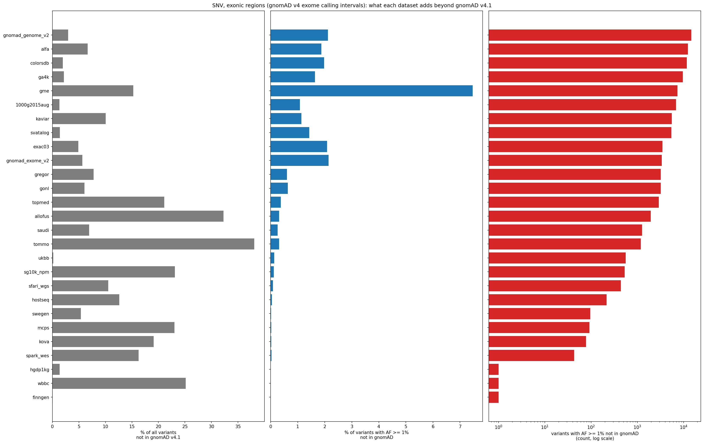

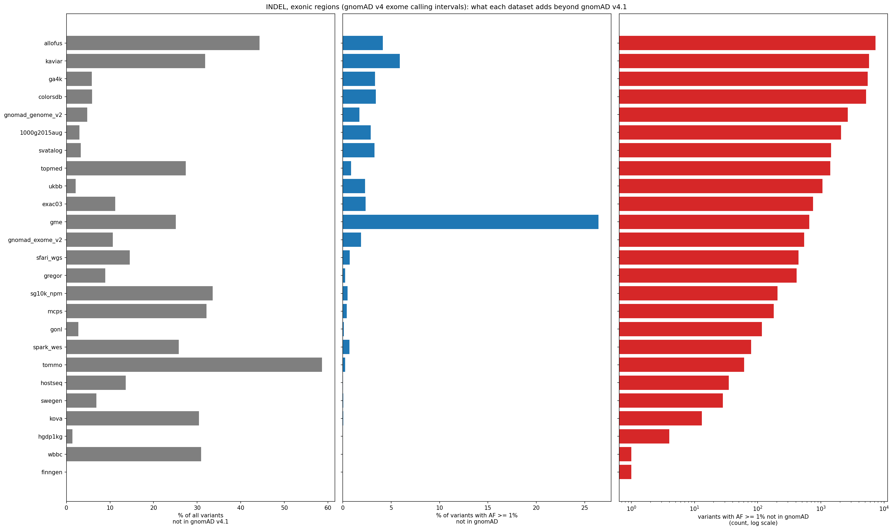

#### Non-exonic regions, SNVs

| Dataset | Variants | % not in gnomAD | Variants AF ≥ 1% | AF ≥ 1% not in gnomAD | % AF ≥ 1% not in gnomAD |
|---|---:|---:|---:|---:|---:|
| colorsdb | 36,899,589 | 10.06% | 12,361,062 | 1,359,440 | 11.00% |
| topmed | 742,117,766 | 40.48% | 16,021,874 | 1,226,186 | 7.65% |
| tommo | 196,076,062 | 64.84% | 7,564,035 | 542,809 | 7.18% |
| swegen | 29,996,166 | 17.46% | 10,086,068 | 626,454 | 6.21% |
| alfa | 136,086,372 | 14.48% | 12,964,190 | 777,811 | 6.00% |
| ga4k | 26,058,276 | 6.76% | 11,617,533 | 645,590 | 5.56% |
| sg10k_npm | 149,387,922 | 45.29% | 9,487,423 | 486,046 | 5.12% |
| gonl | 24,726,537 | 14.21% | 10,102,223 | 517,618 | 5.12% |
| sfari_wgs | 141,794,374 | 24.57% | 10,199,534 | 486,383 | 4.77% |
| svatalog | 7,130,203 | 1.61% | 7,130,203 | 115,072 | 1.61% |
| kova | 37,498,359 | 35.95% | 6,595,513 | 99,389 | 1.51% |
| gnomad_genome_v2 | 213,863,282 | 5.09% | 13,127,098 | 193,831 | 1.48% |
| kaviar | 156,482,085 | 22.33% | 9,875,584 | 107,304 | 1.09% |
| 1000g2015aug | 76,455,109 | 2.04% | 12,132,466 | 99,113 | 0.82% |
| allofus | 935,654,106 | 58.23% | 12,310,970 | 92,806 | 0.75% |
| saudi | 24,054,746 | 11.34% | 8,976,432 | 30,749 | 0.34% |
| gregor | 80,225,986 | 15.34% | 10,226,966 | 25,434 | 0.25% |
| ukbb | 11,687,951 | 0.26% | 8,184,777 | 16,408 | 0.20% |
| wbbc | 68,189,102 | 43.42% | 6,668,188 | 8,569 | 0.13% |
| mcps | 116,028,585 | 35.01% | 7,962,226 | 9,465 | 0.12% |
| finngen | 17,094,529 | 0.43% | 8,329,131 | 5,692 | 0.07% |
| hostseq | 146,280,728 | 25.49% | 9,775,222 | 1,394 | 0.01% |
| hgdp1kg | 122,222,115 | 2.53% | 12,372,584 | 106 | 0.00% |

#### Non-exonic regions, INDELs

| Dataset | Variants | % not in gnomAD | Variants AF ≥ 1% | AF ≥ 1% not in gnomAD | % AF ≥ 1% not in gnomAD |
|---|---:|---:|---:|---:|---:|
| kaviar | 29,276,373 | 48.00% | 2,233,523 | 187,526 | 8.40% |
| allofus | 115,827,225 | 56.12% | 4,958,303 | 364,272 | 7.35% |
| colorsdb | 10,853,016 | 9.72% | 4,143,799 | 233,708 | 5.64% |
| ga4k | 8,470,481 | 7.36% | 4,388,251 | 210,991 | 4.81% |
| svatalog | 962,937 | 3.71% | 962,937 | 35,723 | 3.71% |
| tommo | 15,842,994 | 72.11% | 515,461 | 14,221 | 2.76% |
| sg10k_npm | 11,550,951 | 46.15% | 805,749 | 20,453 | 2.54% |
| 1000g2015aug | 3,314,343 | 3.37% | 1,539,756 | 37,266 | 2.42% |
| ukbb | 1,194,738 | 2.27% | 1,018,043 | 24,022 | 2.36% |
| topmed | 76,564,899 | 35.14% | 4,410,155 | 102,991 | 2.34% |
| sfari_wgs | 15,892,695 | 20.13% | 1,456,874 | 33,365 | 2.29% |
| swegen | 3,191,048 | 11.52% | 1,058,851 | 19,578 | 1.85% |
| gnomad_genome_v2 | 31,659,387 | 5.64% | 3,978,968 | 40,786 | 1.03% |
| mcps | 10,075,091 | 31.70% | 929,497 | 6,996 | 0.75% |
| gonl | 7,227,701 | 4.08% | 3,296,853 | 19,176 | 0.58% |
| kova | 2,676,058 | 38.81% | 461,856 | 2,544 | 0.55% |
| gregor | 19,267,808 | 10.29% | 4,936,718 | 21,172 | 0.43% |
| wbbc | 5,639,302 | 36.37% | 443,324 | 698 | 0.16% |
| hostseq | 24,463,140 | 15.76% | 3,685,637 | 1,816 | 0.05% |
| finngen | 1,788,917 | 0.11% | 952,086 | 209 | 0.02% |
| hgdp1kg | 20,972,276 | 1.49% | 4,183,712 | 90 | 0.00% |

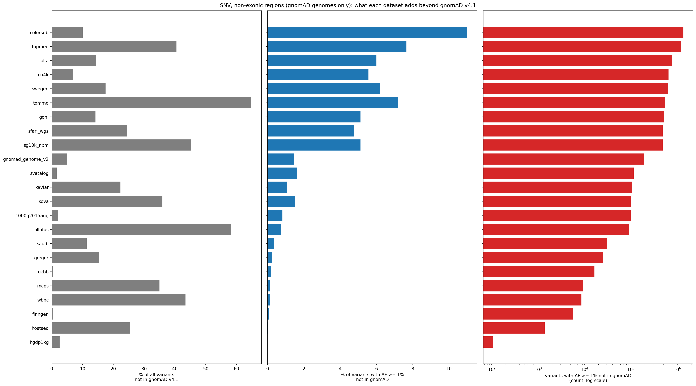

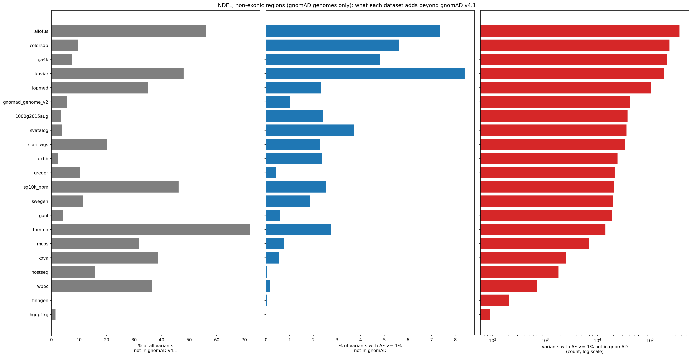

### 3. How gnomAD classifies each dataset's polymorphisms (step 2)

Of each dataset's polymorphisms (AF > 10%), the share that gnomAD calls rare (< 5%), and the share absent or QC-failed, under the three gnomAD views: overall AF, the population maximum (popmax) and the dataset's matching gnomAD group.

#### Exonic

| Dataset | Type | Polymorphisms | Rare in gnomAD (overall) | Rare (popmax) | Rare (matched group) | Absent / QC fail (popmax) |
|---|---:|---:|---:|---:|---:|---:|
| FinnGen (Finland) | SNV | 236,547 | 0.80% | 0.06% | 4.05% | 0.00% |
| GME (Middle East) | SNV | 36,497 | 10.14% | 8.16% | 9.38% | 3.29% |
| GoNL (Netherlands) | SNV | 266,382 | 2.54% | 1.66% | 3.89% | 0.06% |
| KOVA (Korea) | SNV | 203,390 | 9.18% | 0.20% | 3.32% | 0.00% |
| MCPS (Mexico) | SNV | 241,011 | 6.74% | 0.35% | 2.97% | 0.01% |
| SG10K (Singapore) | SNV | 261,835 | 7.63% | 0.35% | 4.52% | 0.00% |
| Saudi Arabia | SNV | 235,199 | 3.23% | 0.19% | 4.01% | 0.00% |
| SweGen (Sweden) | SNV | 278,846 | 3.03% | 1.65% | 4.37% | 0.00% |
| ToMMo (Japan) | SNV | 218,927 | 11.65% | 1.91% | 5.72% | 0.30% |
| UK Biobank | SNV | 240,045 | 1.25% | 0.62% | 2.62% | 0.13% |
| WBBC (China) | SNV | 215,414 | 8.22% | 0.13% | 3.12% | 0.00% |
| allofus | SNV | 277,765 | 4.54% | 2.36% |  | 0.28% |
| topmed | SNV | 329,952 | 9.85% | 5.84% |  | 0.60% |
| FinnGen (Finland) | INDEL | 24,224 | 1.95% | 0.24% | 5.07% | 0.00% |
| GME (Middle East) | INDEL | 810 | 35.43% | 35.68% | 38.15% | 21.61% |
| GoNL (Netherlands) | INDEL | 44,011 | 3.88% | 1.55% | 5.94% | 0.01% |
| KOVA (Korea) | INDEL | 14,423 | 10.19% | 0.28% | 3.96% | 0.00% |
| MCPS (Mexico) | INDEL | 25,694 | 7.83% | 1.60% | 4.85% | 0.31% |
| SG10K (Singapore) | INDEL | 22,328 | 9.71% | 1.09% | 6.40% | 0.00% |
| SweGen (Sweden) | INDEL | 26,935 | 3.75% | 1.56% | 5.84% | 0.01% |
| ToMMo (Japan) | INDEL | 13,877 | 12.70% | 1.68% | 5.72% | 0.30% |
| UK Biobank | INDEL | 30,090 | 4.10% | 2.55% | 6.65% | 2.55% |
| WBBC (China) | INDEL | 9,311 | 11.78% | 0.21% | 3.79% | 0.00% |
| allofus | INDEL | 70,486 | 15.04% | 9.48% |  | 2.31% |
| topmed | INDEL | 63,310 | 9.58% | 3.74% |  | 0.64% |

#### Non-exonic

| Dataset | Type | Polymorphisms | Rare in gnomAD (overall) | Rare (popmax) | Rare (matched group) | Absent / QC fail (popmax) |
|---|---:|---:|---:|---:|---:|---:|
| FinnGen (Finland) | SNV | 4,760,832 | 0.28% | 0.00% | 0.00% | 0.04% |
| GoNL (Netherlands) | SNV | 5,466,674 | 1.38% | 1.15% | 1.49% | 2.09% |
| KOVA (Korea) | SNV | 3,910,694 | 6.33% | 0.02% | 0.03% | 0.21% |
| MCPS (Mexico) | SNV | 4,884,843 | 4.62% | 0.43% | 0.73% | 0.08% |
| SG10K (Singapore) | SNV | 5,383,800 | 4.88% | 0.08% | 0.57% | 1.36% |
| Saudi Arabia | SNV | 4,609,585 | 1.30% | 0.07% | 0.36% | 0.05% |
| SweGen (Sweden) | SNV | 5,571,186 | 0.96% | 0.60% | 1.03% | 3.41% |
| ToMMo (Japan) | SNV | 4,403,575 | 7.25% | 0.97% | 1.32% | 4.30% |
| UK Biobank | SNV | 4,866,454 | 0.57% | 0.48% | 0.65% | 0.19% |
| WBBC (China) | SNV | 4,198,467 | 5.93% | 0.00% | 0.00% | 0.06% |
| allofus | SNV | 5,690,166 | 1.98% | 1.65% |  | 0.66% |
| topmed | SNV | 6,871,557 | 5.70% | 5.20% |  | 5.85% |
| FinnGen (Finland) | INDEL | 513,986 | 0.29% | 0.00% | 0.01% | 0.02% |
| GoNL (Netherlands) | INDEL | 1,109,054 | 2.78% | 2.00% | 3.04% | 0.39% |
| KOVA (Korea) | INDEL | 272,038 | 6.38% | 0.02% | 0.03% | 0.10% |
| MCPS (Mexico) | INDEL | 555,743 | 5.86% | 1.72% | 2.32% | 0.59% |
| SG10K (Singapore) | INDEL | 431,034 | 5.62% | 0.33% | 1.11% | 0.62% |
| SweGen (Sweden) | INDEL | 572,462 | 1.04% | 0.63% | 1.04% | 1.21% |
| ToMMo (Japan) | INDEL | 290,094 | 7.82% | 0.93% | 1.33% | 1.95% |
| UK Biobank | INDEL | 702,507 | 2.77% | 2.18% | 3.26% | 2.33% |
| WBBC (China) | INDEL | 167,469 | 8.84% | 0.04% | 0.06% | 0.06% |
| allofus | INDEL | 1,946,962 | 9.13% | 8.32% |  | 5.45% |
| topmed | INDEL | 1,652,173 | 3.86% | 2.93% |  | 1.89% |

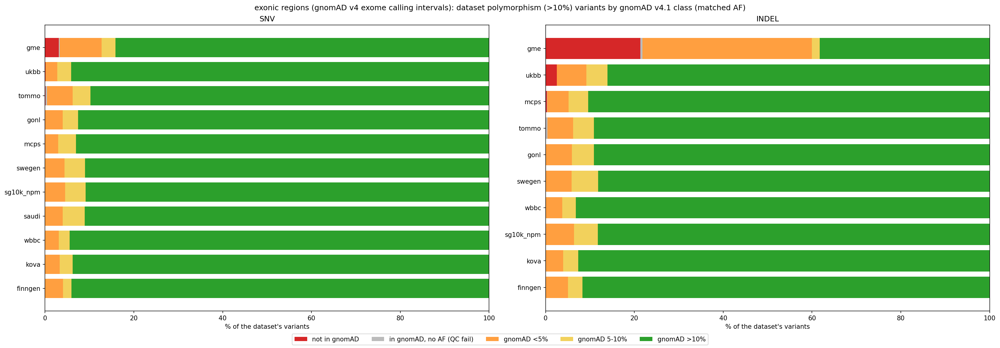

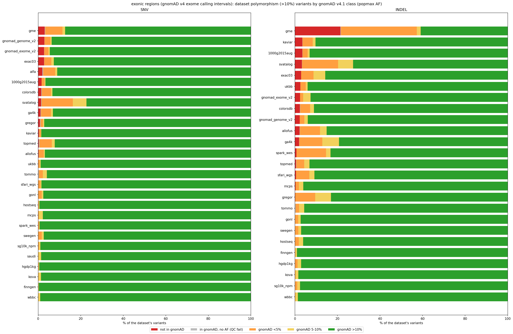

### 4. The opposite direction: rare in the dataset, polymorphic in gnomAD (step 2)

Of each dataset's rare variants (AF < 5%), the share that gnomAD calls polymorphic (> 10%).

#### Exonic

| Dataset | Type | Rare variants | Polymorphic in gnomAD (overall) | Polymorphic (matched group) | Polymorphic (popmax) |
|---|---:|---:|---:|---:|---:|
| FinnGen (Finland) | SNV | 699,924 | 0.61% | 0.35% | 8.54% |
| GME (Middle East) | SNV | 628,724 | 0.07% | 0.05% | 1.70% |
| GoNL (Netherlands) | SNV | 1,013,056 | 1.02% | 0.78% | 7.74% |
| KOVA (Korea) | SNV | 2,669,448 | 1.09% | 0.12% | 2.49% |
| MCPS (Mexico) | SNV | 11,682,203 | 0.12% | 0.02% | 0.99% |
| SG10K (Singapore) | SNV | 8,624,430 | 0.31% | 0.05% | 1.28% |
| Saudi Arabia | SNV | 1,140,784 | 0.56% | 0.19% | 7.07% |
| SweGen (Sweden) | SNV | 1,325,162 | 0.52% | 0.40% | 5.60% |
| ToMMo (Japan) | SNV | 11,654,969 | 0.27% | 0.02% | 0.85% |
| UK Biobank | SNV | 486,965 | 0.75% | 0.43% | 12.19% |
| WBBC (China) | SNV | 4,180,345 | 0.72% | 0.04% | 1.85% |
| allofus | SNV | 58,259,259 | 0.01% |  | 0.14% |
| topmed | SNV | 45,155,519 | 0.02% |  | 0.17% |
| FinnGen (Finland) | INDEL | 63,475 | 2.47% | 1.31% | 13.29% |
| GME (Middle East) | INDEL | 9,304 | 0.15% | 0.11% | 1.26% |
| GoNL (Netherlands) | INDEL | 223,527 | 8.27% | 7.97% | 19.18% |
| KOVA (Korea) | INDEL | 194,511 | 1.12% | 0.12% | 2.60% |
| MCPS (Mexico) | INDEL | 833,808 | 0.31% | 0.13% | 1.62% |
| SG10K (Singapore) | INDEL | 705,511 | 0.32% | 0.06% | 1.36% |
| SweGen (Sweden) | INDEL | 135,249 | 1.65% | 1.44% | 7.29% |
| ToMMo (Japan) | INDEL | 882,999 | 0.27% | 0.04% | 0.84% |
| UK Biobank | INDEL | 22,817 | 1.98% | 0.95% | 21.31% |
| WBBC (China) | INDEL | 314,757 | 1.72% | 0.62% | 4.11% |
| allofus | INDEL | 6,286,179 | 0.21% |  | 0.56% |
| topmed | INDEL | 4,225,529 | 0.36% |  | 0.91% |

#### Non-exonic

| Dataset | Type | Rare variants | Polymorphic in gnomAD (overall) | Polymorphic (matched group) | Polymorphic (popmax) |
|---|---:|---:|---:|---:|---:|
| FinnGen (Finland) | SNV | 11,270,584 | 1.36% | 0.03% | 9.19% |
| GoNL (Netherlands) | SNV | 17,829,661 | 1.55% | 0.61% | 7.61% |
| KOVA (Korea) | SNV | 32,789,173 | 1.63% | 0.05% | 3.18% |
| MCPS (Mexico) | SNV | 110,202,031 | 0.29% | 0.04% | 1.83% |
| SG10K (Singapore) | SNV | 142,668,755 | 0.37% | 0.02% | 1.32% |
| Saudi Arabia | SNV | 18,374,223 | 0.43% | 0.10% | 7.21% |
| SweGen (Sweden) | SNV | 23,087,723 | 0.82% | 0.19% | 5.41% |
| ToMMo (Japan) | SNV | 190,072,136 | 0.32% | 0.01% | 0.88% |
| UK Biobank | SNV | 5,764,033 | 2.49% | 0.06% | 16.06% |
| WBBC (China) | SNV | 63,213,030 | 0.94% | 0.01% | 2.10% |
| allofus | SNV | 928,497,626 | 0.00% |  | 0.13% |
| topmed | SNV | 733,171,965 | 0.01% |  | 0.15% |
| FinnGen (Finland) | INDEL | 1,141,854 | 1.70% | 0.07% | 12.86% |
| GoNL (Netherlands) | INDEL | 5,599,120 | 5.61% | 4.71% | 14.70% |
| KOVA (Korea) | INDEL | 2,346,094 | 1.68% | 0.06% | 3.33% |
| MCPS (Mexico) | INDEL | 9,408,659 | 0.47% | 0.11% | 2.62% |
| SG10K (Singapore) | INDEL | 11,004,729 | 0.39% | 0.02% | 1.42% |
| SweGen (Sweden) | INDEL | 2,474,476 | 0.95% | 0.25% | 6.49% |
| ToMMo (Japan) | INDEL | 15,457,587 | 0.33% | 0.03% | 0.91% |
| UK Biobank | INDEL | 372,907 | 4.55% | 0.31% | 26.25% |
| WBBC (China) | INDEL | 5,404,978 | 1.38% | 0.05% | 3.45% |
| allofus | INDEL | 113,146,837 | 0.00% |  | 0.31% |
| topmed | INDEL | 74,215,970 | 0.12% |  | 0.67% |

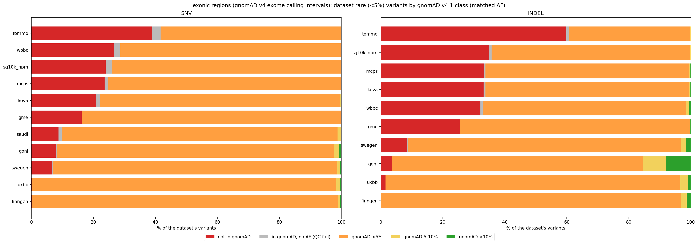

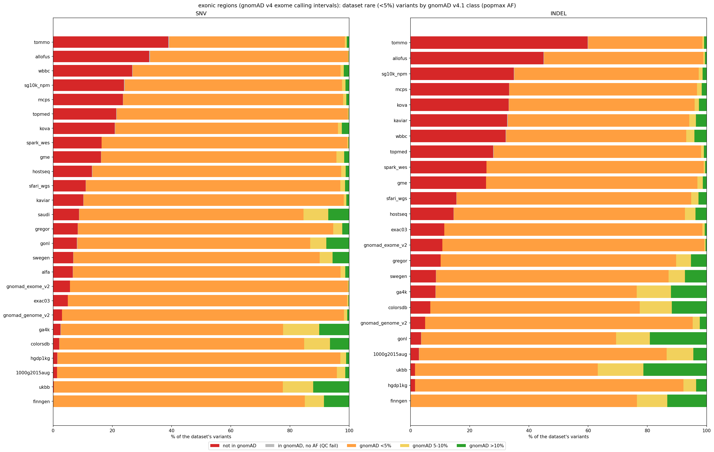

### 5. Population markers and structure (step 3)

Exonic SNVs with AF > 10% in the dataset and gnomAD popmax < 5% or absent, per country dataset:

| Dataset | Marker SNVs | Absent / QC fail in gnomAD | Rare (< 5%) in every gnomAD group |
|---|---:|---:|---:|
| ToMMo (Japan) | 4,820 | 648 | 4,172 |
| SweGen (Sweden) | 4,624 | 18 | 4,606 |
| GoNL (Netherlands) | 4,591 | 168 | 4,423 |
| GME (Middle East) | 4,179 | 1,202 | 2,977 |
| UK Biobank | 1,807 | 312 | 1,495 |
| SG10K (Singapore) | 919 | 11 | 908 |
| MCPS (Mexico) | 896 | 42 | 854 |
| Saudi Arabia | 449 | 1 | 448 |
| KOVA (Korea) | 401 | 0 | 401 |
| WBBC (China) | 271 | 0 | 271 |
| FinnGen (Finland) | 131 | 0 | 131 |

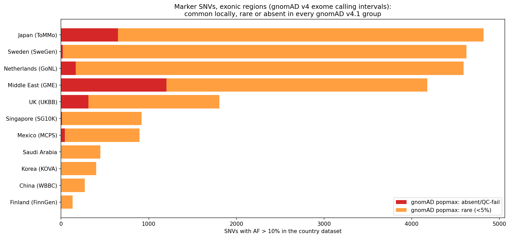

Population PCA on allele frequencies (exonic SNVs with gnomAD genome AF, AF ≥ 1% somewhere, one per 100 kb) and the mean absolute AF difference between populations:

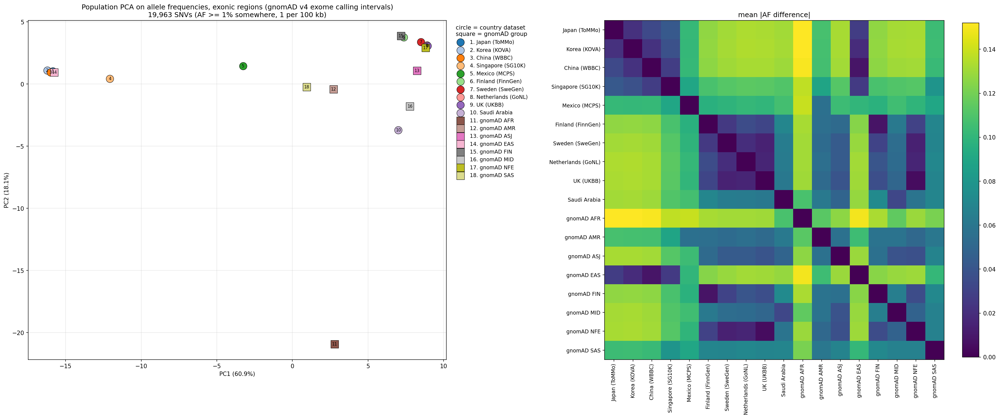

### 6. ClinVar (step 4)

ClinVar (2026-11-15) variants with AF ≥ 5% in at least one dataset and gnomAD popmax < 5% or absent, by the number of independent datasets supporting the high frequency (gnomAD v2 and ExAC counted with gnomAD).

#### Exonic

| ClinVar group | 0 dataset(s) | 1 dataset(s) | 2 dataset(s) | 3 dataset(s) | 4+ dataset(s) | Total |
|---|---:|---:|---:|---:|---:|---:|
| Conflicting | 14 | 682 | 44 | 18 | 6 | 764 |
| P/LP | 1 | 127 | 9 | 1 | 2 | 140 |
| VUS | 41 | 1,261 | 129 | 37 | 36 | 1,504 |

#### Non-exonic

| ClinVar group | 1 dataset(s) | 2 dataset(s) | 3 dataset(s) | 4+ dataset(s) | Total |
|---|---:|---:|---:|---:|---:|
| Conflicting | 5 | 0 | 0 | 0 | 5 |
| P/LP | 1 | 0 | 0 | 0 | 1 |
| VUS | 19 | 11 | 5 | 4 | 39 |

Exonic pathogenic / likely pathogenic variants supported by two or more datasets:

| Chr | Start | Ref | Alt | Gene | ClinVar | Stars | Max AF | gnomAD popmax | Datasets (AF) |
|---|---:|---:|---:|---:|---:|---:|---:|---:|---:|
| 19 | 1037767 | G | A | CNN2 | Pathogenic | 1 | 0.492488 | 0.0004 | gnomad_genome_v2:0.2552;tommo:0.134746;swegen:0.275;topmed:0.492488;alfa:0.2039 |
| 19 | 1037757 | G | A | CNN2 | Pathogenic | 1 | 0.491832 | 0.0008 | gnomad_genome_v2:0.2514;tommo:0.135418;swegen:0.2575;topmed:0.491832;alfa:0.3563 |
| 10 | 48066 | C | A | TUBB8 | Likely_pathogenic | 1 | 0.3585 | 0.0013 | gnomad_genome_v2:0.0591;swegen:0.3585;topmed:0.051899;alfa:0.0991 |
| 7 | 142750600 | A | T | PRSS1 | Pathogenic | 2 | 0.4751 | 2.382e-05 | gnomad_exome_v2:0.2927;gnomad_genome_v2:0.2676;exac03:0.4751;gme:0.450058;alfa:0.1841 |
| 5 | 126577145 | T | C | ALDH7A1 | Pathogenic | 2 | 0.282934 | 2.987e-05 | mcps:0.282934;alfa:0.1414 |
| 7 | 142750600 | A | C | PRSS1 | Pathogenic | 2 | 0.255 | 7.241e-05 | swegen:0.0725;gonl:0.255 |
| 14 | 77027444 | G | A | IRF2BPL | Likely_pathogenic | 2 | 0.1644 | 0 | topmed:0.0824194;alfa:0.1644 |
| 8 | 100705591 | A | G | PABPC1 | Pathogenic | 1 | 0.135585 | 0.0067 | gme:0.135585;gonl:0.053 |
| 14 | 77027450 | G | A | IRF2BPL | Likely_pathogenic | 1 | 0.132 | 4.944e-05 | topmed:0.0657195;alfa:0.132 |
| 7 | 152248171 | G | A | KMT2C | Pathogenic | 1 | 0.125926 | . | gme:0.125926;alfa:0.0898 |
| 3 | 186079931 | T | G | ETV5 | Pathogenic | 1 | 0.121628 | 0.0341 | topmed:0.121628;alfa:0.0602 |
| 13 | 20189473 | C | T | GJB2 | Pathogenic | 3 | 0.0977679 | 0.0415 | sg10k_npm:0.075807;wbbc:0.0977679 |

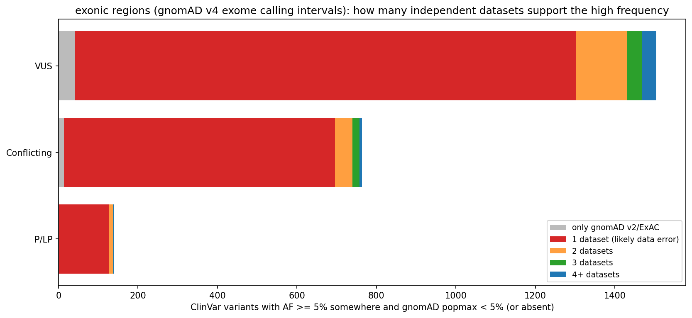

### 7. Gene level (step 5, exonic, protein-coding genes)

Genes significantly above (high) or below (low) the gnomAD expectation (FDR < 5%, ≥ 2-fold, ≥ 5 variants); PA = protein-altering, syn = synonymous (technical control), common = AF ≥ 1%.

| Dataset | PA common high | PA common low | syn common high | PA all high | PA all low |
|---|---:|---:|---:|---:|---:|
| gme | 385 | 178 | 107 | 391 | 930 |
| colorsdb | 121 | 15 | 74 | 1081 | 1038 |
| ga4k | 101 | 15 | 55 | 863 | 361 |
| alfa | 87 | 13 | 35 | 50 | 1229 |
| topmed | 84 | 3 | 48 | 14 | 380 |
| allofus | 75 | 115 | 18 | 4 | 831 |
| kaviar | 52 | 47 | 7 | 161 | 1412 |
| gnomad_genome_v2 | 51 | 23 | 19 | 108 | 904 |
| swegen | 44 | 12 | 17 | 430 | 179 |
| 1000g2015aug | 39 | 85 | 9 | 435 | 1644 |
| exac03 | 39 | 61 | 8 | 40 | 1760 |
| saudi | 35 | 163 | 6 | 548 | 406 |
| tommo | 34 | 19 | 21 | 53 | 253 |
| gnomad_exome_v2 | 33 | 46 | 10 | 39 | 954 |
| hgdp1kg | 27 | 52 | 8 | 267 | 1413 |
| svatalog | 23 | 7 | 6 | 358 | 5 |
| gonl | 20 | 25 | 2 | 419 | 266 |
| gregor | 18 | 18 | 2 | 388 | 1096 |
| sg10k_npm | 11 | 24 | 4 | 107 | 1027 |
| wbbc | 10 | 64 | 1 | 236 | 1849 |
| kova | 7 | 31 | 3 | 227 | 817 |
| hostseq | 7 | 43 | 1 | 92 | 1466 |
| sfari_wgs | 6 | 10 | 2 | 125 | 901 |
| spark_wes | 5 | 36 | 0 | 0 | 929 |
| finngen | 3 | 100 | 0 | 256 | 71 |
| mcps | 2 | 88 | 0 | 10 | 1101 |
| ukbb | 1 | 96 | 0 | 751 | 470 |

Uniqueness of genes high for common protein-altering variants:

| Pattern | Genes |
|---|---:|
| unique to one dataset | 485 |
| one population group | 129 |
| several groups | 119 |

Genes high in the most datasets:

| Gene | Datasets | Population groups |
|---|---:|---:|
| ZNF473 | 17 | Middle East,multi-population / other |
| OR6K6 | 17 | Middle East,multi-population / other |
| VCX3A | 13 | East Asia,Middle East,multi-population / other |
| LYST | 12 | Middle East,multi-population / other |
| OR4N5 | 12 | East Asia,Middle East,multi-population / other |
| VRK3 | 11 | Middle East,multi-population / other |
| ZNF729 | 9 | Europe,multi-population / other |
| PRAMEF14 | 9 | East Asia,Europe,Middle East,multi-population / other |
| MUC8 | 8 | multi-population / other |
| FAM8A1 | 8 | East Asia,Europe,Middle East,multi-population / other |
| CEACAM3 | 8 | multi-population / other |
| RHD | 8 | Middle East,multi-population / other |
| HLA-C | 8 | multi-population / other |
| MUC21 | 7 | East Asia,Middle East,multi-population / other |
| OR5H14 | 7 | multi-population / other |
| TAS2R46 | 7 | East Asia,Europe,multi-population / other |
| NBPF1 | 7 | Europe,Middle East,multi-population / other |
| NACA | 7 | East Asia,multi-population / other |
| TCHH | 7 | East Asia,multi-population / other |
| OR4C3 | 6 | Middle East,multi-population / other |
| SPATA31A7 | 6 | East Asia,Middle East,multi-population / other |
| OR4M2 | 6 | Middle East,multi-population / other |
| TAS2R30 | 6 | East Asia,Europe,multi-population / other |
| DNAH10 | 6 | Middle East,multi-population / other |
| ZNF257 | 6 | East Asia,Europe,multi-population / other |

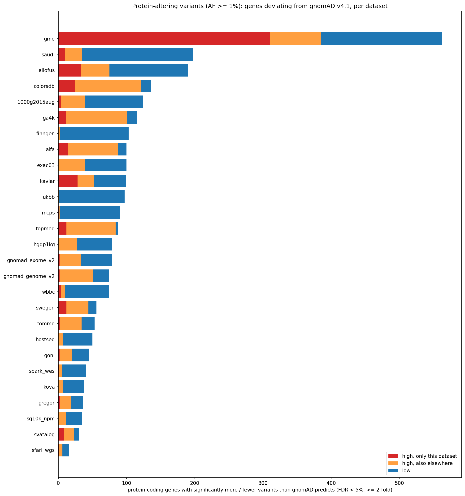

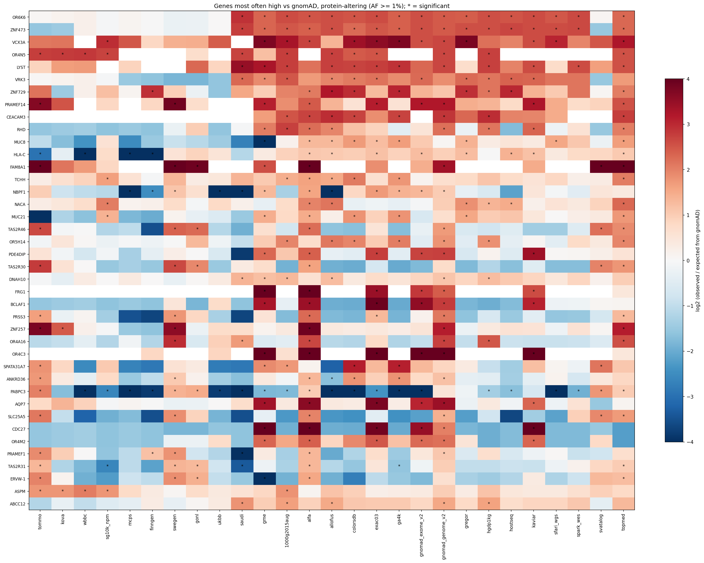

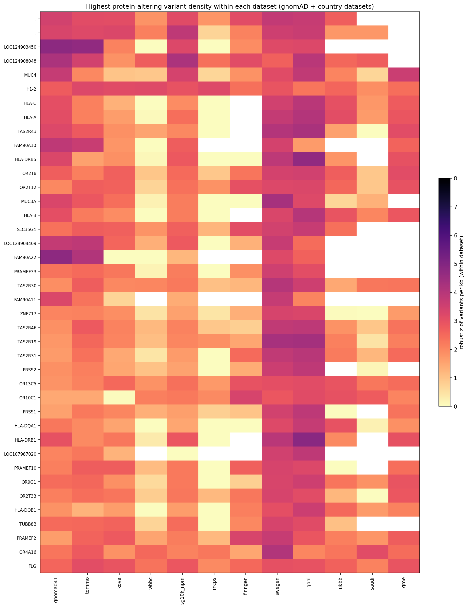

## Data-quality audit

Problems found in public frequency resources and in intermediate processing during this study. Each would have changed
the conclusions if left uncorrected.

### Errors in public resources

| Source | Problem | Evidence | Handling |
|---|---|---|---|
| UCSC ALFA VCF | Indel positions one base too far right | On chr22, REF matches hg38 at POS−1 for 100% of indels and at POS for 5%; 99% of ALFA indels were absent from gnomAD before correction; shifting −1 raised the match to 79% (deletions) and 57% (insertions) | Indels shifted −1 in the union; left out of the frequency analyses (SNVs kept) |
| UCSC GenomeAsia (`varFreqsAll.bb`) | Unreliable frequencies | REF matches hg38, but ~25% of variants at AF 10–90% are absent from both TOPMed and gnomAD | Excluded from the frequency analyses |
| UCSC SPARK, ToMMo (`varFreqsAll.bb`) | Records with tiny allele numbers | e.g. AC = 3 with AF = 1; AC = 1 with AF = 0.5 (AN = 2). These made 960 rare pathogenic variants look common (SPARK) and pushed ToMMo's share of common SNVs absent from gnomAD to 14% (all regions, before the rule; 0.3% exonic and 7.2% non-exonic after it) | AF ignored when AN (or AC/AF) < 100 |
| UCSC `varFreqsAll.bb` | Column order differs from its own schema | Rows with a single source cohort fill another cohort's columns (e.g. SPARK values under `indAC`) | Header rebuilt from the data, verified on 20 M rows |
| UCSC `varFreqsAll.bb` | IndiGen listed in the schema but never a source | Its columns are always empty | Not used |
| gnomAD v4.1 (ANNOVAR tables) | Rows with AF = 0 | Variant seen only in QC-failed genotypes; 60–90% of "common locally, rare in gnomAD" calls were these rows | Treated as no AF; genome AF used in exonic regions |
| gnomAD v4.1 exomes (ANNOVAR table) | Missing group AFs | 12–26% of common sites have no AF for a given group (not assessed in part of the exome data) | Group AF taken from gnomAD genomes |
| ANNOVAR hg38 1000 Genomes | Encoded indel alleles | `0C`, `1AC`, `21` = `<ref length><alt>`; plain SNVs have no prefix | Decoded |
| GME (ANNOVAR) | Indels | 21.6% of GME indel polymorphisms absent from gnomAD, 35.7% rare in every group; several implausible pathogenic indels at ~50% (BRCA2, ASPM) | Reported with a caveat |
| Single-dataset clinical frequencies | Implausible AFs for known pathogenic variants | ALFA MYH7 74%, SVatalog CFTR F508del 77%, GME BRCA2 deletion 47%, UK Biobank ABCC6 deletion 99.99% | ClinVar flags require ≥ 2 independent datasets |

### Errors in the analysis itself, found and fixed

| Problem | Effect before the fix | Fix |
|---|---|---|
| ANNOVAR `.idx` bins are not listed in file order | Chromosome slices read half of gnomAD, All of Us and Kaviar; common SNVs looked 26% "absent from gnomAD" in every dataset | Slice from the smallest start to the largest end offset; verified against full-file counts |
| Insertions written with `-` were shifted one base in an early overlap script | `-` and anchored forms of the same insertion counted twice | Anchor rule fixed before the union was built |
| Allele de-duplication by position only before VEP | ~34 M variants left unannotated | De-duplication on the whole allele; a check reports unannotated variants |
| A file glob picked up the list of SNVs missing from the VEP lookup twice | Those SNVs counted twice per gene | Distinct file names per intermediate list |

## Additional analyses

Five analyses built on the study's harmonised outputs. None of them needs the raw frequency files: they read the
kept archive (`data/archive/`: the exonic variant table with every dataset's AF, gene-level tables, PCA matrices)
and public reference data. Nothing under `/home/HUVYA` is used. Each analysis writes to its own folder
(`results/<NN_analysis>/{tables,figures}`), and its scripts are in [`scripts/analyses/`](../scripts/analyses).

Datasets used as "population datasets" in sections 2–5: all frequency-study datasets except disease cohorts
(SPARK, SFARI WGS, GREGoR, GA4K) and earlier gnomAD releases (gnomAD v2, ExAC), which are not independent of gnomAD.

### 1. Shared input: ClinVar P/LP alleles with population frequencies

`prep_clinvar_plp.sh`

- ClinVar 2026-11-15: 367,692 records with CLNSIG starting "Pathogenic" or "Likely_pathogenic"; 367,679 normalised alleles.
- AF in every population dataset: join with the exonic variant table (155,323 P/LP alleles are exonic and seen in at least one dataset).
- gnomAD v4.1 per genetic-ancestry group (AFR, AMR, ASJ, EAS, FIN, MID, NFE, SAS), exome and genome: VEP 116 with the
  `Naser_VEP` RefSeq cache (`--af_gnomade --af_gnomadg`); group AF = exome, or genome where the exome has none;
  popmax = highest group AF.

### 2. Founder and population-enriched pathogenic variants

`founder_and_carrier.py` → `results/04_founder_variants/`

**Question.** Which ClinVar P/LP variants are much more frequent in a population than anywhere in gnomAD?

**Method.** A variant is *enriched* in a dataset when its AF there is ≥ 0.1% and ≥ 10 times gnomAD popmax (or it is
absent from gnomAD). It is *high confidence* when it is enriched in at least two datasets, has at least one ClinVar
review star, does not lie in an unreliable gene or a GIAB difficult region (section 4), and its AF is at most 5%
(higher is implausible for a penetrant disease allele).

**Results.**

| | Variants |
|---|---:|
| P/LP variants enriched in at least one dataset | 1,621 |
| Enriched in two or more datasets | 61 |
| High confidence | 32 |

- Per dataset, GME (451) and GoNL (445) have the most enriched variants, followed by ALFA (258) and Saudi (170).
- Among the 32 high-confidence variants, GME takes part in 17, the most of any dataset; Saudi in 5.
- High-confidence pairs between GME and Saudi (ATP6V1B1, ASPA, GSR, ABCC6) are candidate Arab founder alleles;
  others include OTOF, TMC1, SLC7A7 and KCNQ1 (GME with GoNL), SACS and SYCP3 (GME with Kaviar) and BCKDHA (GoNL with KOVA).
- Most replicated "enriched" variants that did not reach high confidence are technical: genes with close paralogs or
  pseudogenes (PRSS1, CNN2, TUBB8, CYP21A2, PI4KA) or implausible frequencies (ASPA at 17%, ALDH7A1 at 28%).

Tables: `founder_candidates_all.tsv`, `founder_candidates_replicated_1star.tsv`, `founder_candidates_high_confidence.tsv`,
`founder_variant_dataset_pairs.tsv` (with the matched gnomAD group AF), `founder_summary_per_dataset.tsv`.

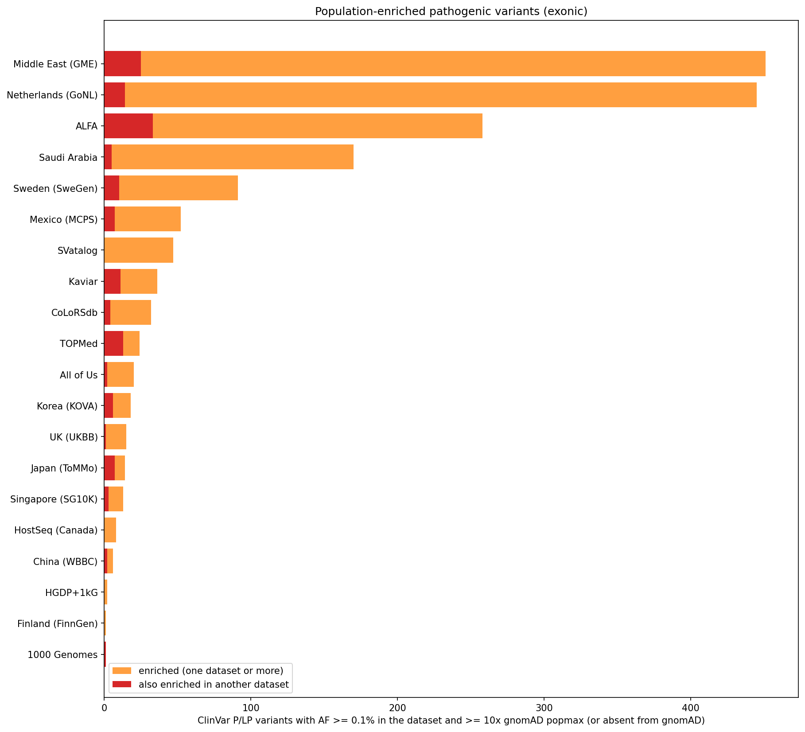

### 3. Carrier frequencies for autosomal recessive disorders

`founder_and_carrier.py` → `results/05_carrier_frequency/`

**Question.** How common are carriers of known pathogenic alleles for recessive disorders in each population?

**Method.**

- Genes: ClinGen gene–disease validity, mode of inheritance AR, classification Definitive, Strong or Moderate
  (1,500 genes; 1,447 with qualifying variants).
- Variants: ClinVar P/LP with ≥ 1 star, coding or canonical-splice consequence (nonsense, frameshift, missense,
  splice donor/acceptor, in-frame, start/stop lost), not low-penetrance or risk alleles. Intronic repeat alleles such as
  CFTR poly-T/TG were excluded because they are classed P/LP with variable penetrance and inflated carrier rates three-fold.
- Quality: aggregate, tiny or long-read reference sets left out (ALFA, Kaviar, SVatalog, CoLoRSdb); the 56 unreliable
  genes left out; a dataset AF ≥ 1% kept only if another source also has the allele ≥ 1% (33 AFs dropped).
- Per gene: pathogenic allele frequency q = sum of AFs; carrier frequency 2q(1−q); expected affected per 100,000
  births q² × 10⁵ (random mating; consanguinity raises this).

**Validation against known carrier rates.**

| Gene | Population | This study | Known |
|---|---|---:|---|
| CFTR | gnomAD NFE (European) | 4.4% | about 1 in 25 (4%) |
| HEXA | gnomAD ASJ (Ashkenazi) | 3.5% | about 1 in 30 (3.3%) |
| HBB | gnomAD AFR | 13.7% | sickle-cell trait 8–25% across African populations |
| GJB2 | gnomAD EAS / SG10K / WBBC | 8.9% / 15.4% / 18.3% | V37I is common in East and Southeast Asia |
| PAH | GME / gnomAD MID | 4.3% / 2.8% | phenylketonuria is frequent in the Middle East |

**Results.** The estimated share of people carrying a known pathogenic allele in at least one AR gene ranges from
47% (UK Biobank, imputed array data that miss rare variants) to 93% (SG10K) and 92% (GME). This share grows with
cohort size and sequencing depth, so it compares technologies as much as populations; per-gene values are the more
reliable output.

Tables: `carrier_frequency_per_gene.tsv`, `pathogenic_allele_frequency_per_gene.tsv`, `expected_affected_per_100k_births.tsv`,
`carrier_summary_per_population.tsv`, `top15_genes_per_population.tsv`.

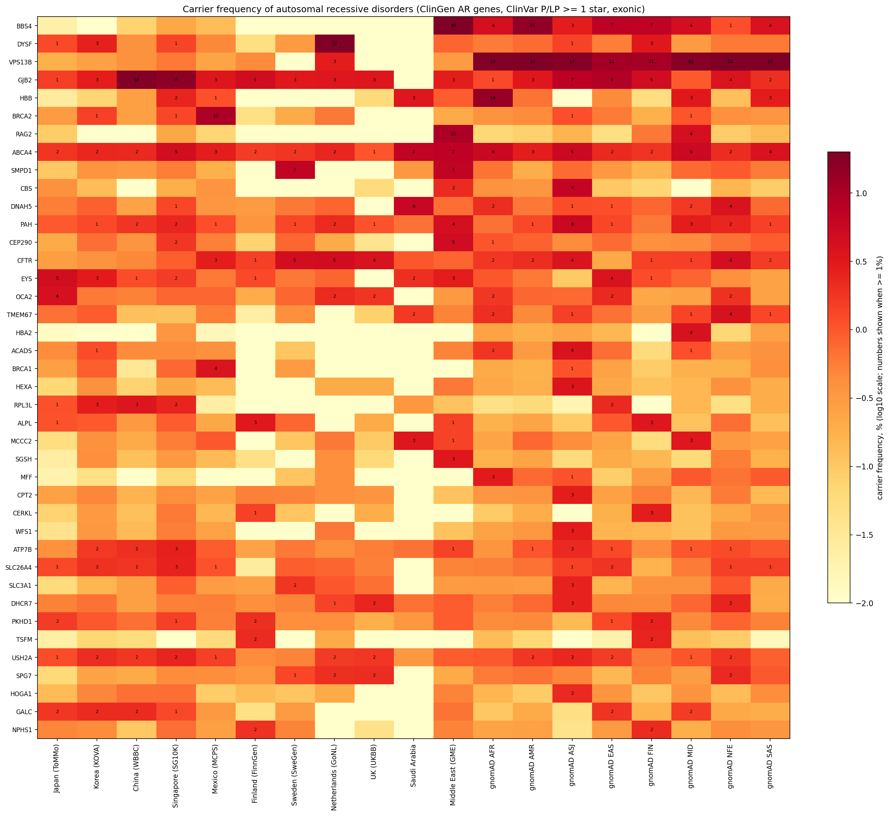

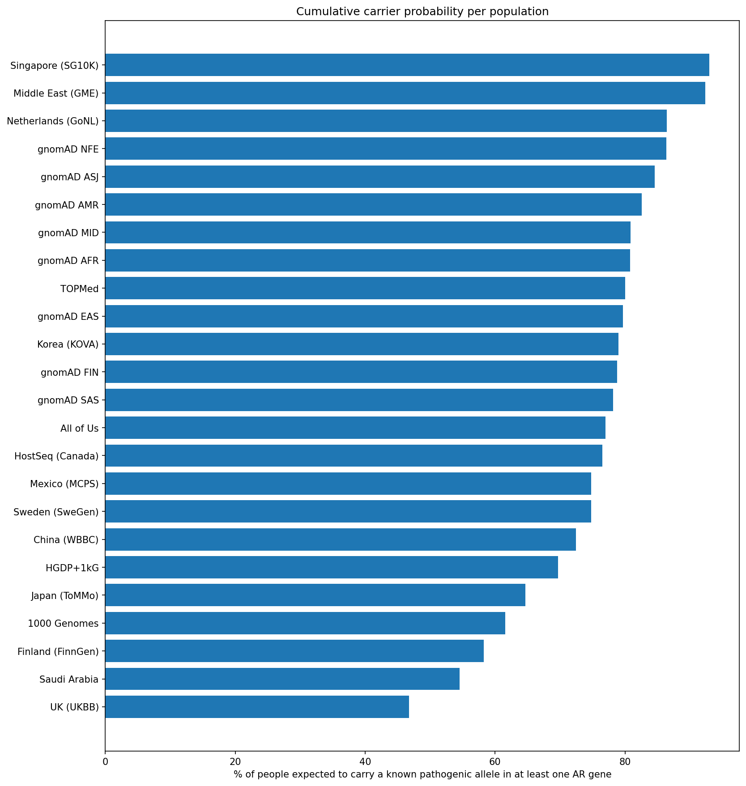

### 4. Genes and variants whose population frequencies should not be trusted

`unreliable_regions.sh`, `unreliable_regions.py` → `results/06_unreliable_regions/`

**Method.** Gene rules (exonic, protein-coding):

- R1: high for common protein-altering variants vs gnomAD in ≥ 5 datasets across ≥ 2 population groups;
- R2: high for common synonymous variants vs gnomAD in ≥ 5 datasets (a technical signal);
- R3: within-dataset protein-altering density outlier in at least half of the datasets.

Validation: share of each gene's exonic footprint inside GIAB v3.5 GRCh38 segmental duplications (166.9 Mb) and
low-mappability regions (248.9 Mb), flagged genes against all other protein-coding genes (one-sided Mann–Whitney U).
Variant list: ClinVar P/LP, VUS and conflicting variants whose ≥ 5% frequency comes from one dataset only.

**Results.**

- 57 unreliable genes (11 meeting at least two rules), for example OR6K6, FAM8A1, MUC21, AQP7, PDE4DIP, ZNF257, ZNF473, VCX3A, LYST.
- GIAB validation:

| GIAB region | Flagged genes: median share inside | Flagged genes > 50% inside | Other genes: median | Other genes > 50% inside | p |
|---|---:|---:|---:|---:|---:|
| Segmental duplications | 48% | 49% | 0% | 7% | 3.4 × 10⁻²⁴ |
| Low mappability | 7% (mean 28%) | 28% | 0% (mean 6%) | 4% | 1.1 × 10⁻¹⁹ |

- 2,151 ClinVar variants have a ≥ 5% frequency that rests on one dataset only; SVatalog (1,212), ALFA (181) and GME (156)
  contribute the most.

Outputs: `unreliable_genes.tsv`, `unreliable_genes.hg38.bed` (for annotation pipelines), `giab_enrichment.tsv`,
`unreliable_variants_clinvar_single_dataset.tsv`, `unreliable_variants_by_dataset.tsv`.

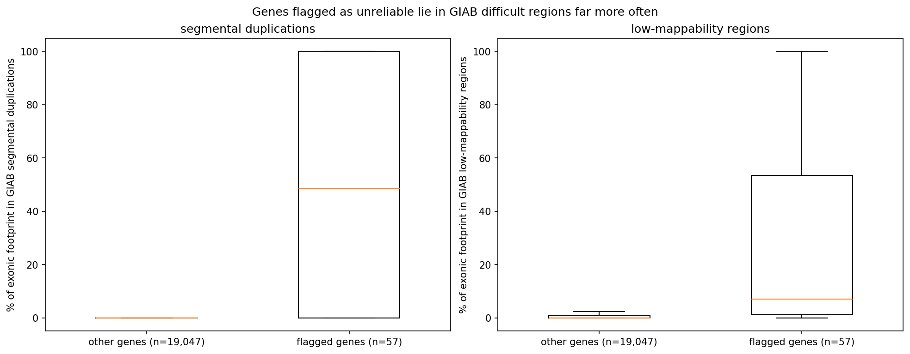

### 5. Candidate ancestry-informative markers for the Middle East

`ancestry_markers.py` → `results/07_ancestry_markers/`

**Method.** SNVs from the study's PCA matrices (exonic and non-exonic) with gnomAD genome AFs. Middle East = mean of
Saudi, gnomAD MID and (in exons) GME, requiring at least two of these sources to agree within 0.1; autosomes only.
Two scores: Rosenberg's informativeness for assignment (In) across Middle East, AFR, AMR, EAS, NFE and SAS; and
ME_gap = the smallest |AF(Middle East) − AF(other group)|, large only when the Middle East differs from every group.
Each list thinned to one SNV per 500 kb; top 1,000 kept.

**Results.** 571,795 exonic and 9,904,927 non-exonic SNVs scored. The Middle East-distinct panel has a median gap of
0.18; its closest other group is most often NFE (411 SNVs), then AMR (234), AFR (165), SAS (144) and EAS (46),
consistent with the Middle East's position between Europe and South Asia. The panel is a selection only: it has not
been tested on individual genotypes.

Tables: `panel_middle_east_distinct_top1000.tsv`, `panel_continental_top1000_informativeness.tsv`, `panel_summary.tsv`.

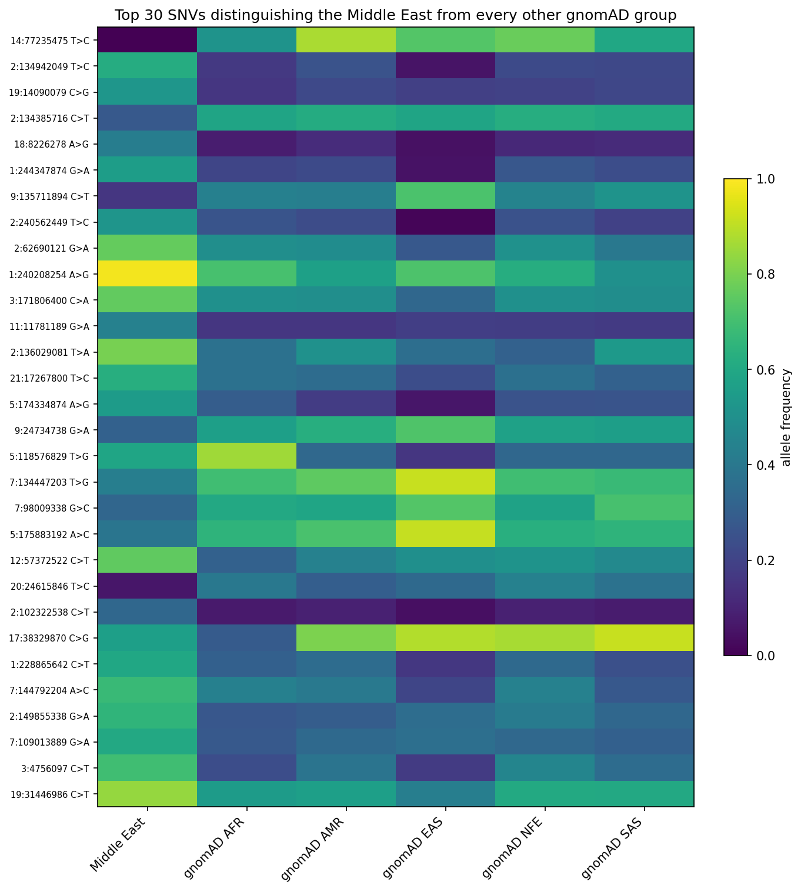

### 6. ACMG reclassification in real genomes

`acmg_impact.sh`, `bias_with_population_af.py`, `acmg_compare.py` → `results/08_acmg_impact/`

**Question.** How many ACMG classifications change when population datasets are added to gnomAD?

Stage `acmg` (optional; `bash scripts/run_all.sh acmg`). Samples are set in `ACMG_SAMPLES` in `scripts/config.sh`.

**Method.**

- Samples: three whole genomes, HUV00001 (copy in `NASER_FILES/Naser_VEP/results`), HUV00002 and HUV00003 (copied
  read-only from the HUVYA WGS output to `extra_analyses/acmg_impact/inputs/`). Each is split into one ALT per record,
  left-aligned (`bcftools norm -m -any -f hg38`), and limited to PASS variants inside the gnomAD v4 exome calling
  intervals: 233,481, 239,153 and 237,108 variants (709,742 in total).
- Annotation: VEP 116 (`Naser_VEP` RefSeq cache, `--everything`, REVEL, AlphaMissense, ClinVar from the BIAS data release).
- Classifier: BIAS-2015, unmodified. A wrapper (`bias_with_population_af.py`) wraps BIAS's variant builder and raises the
  gnomAD `allAf` and `popmax` it uses for BA1, BS1, PM2 and expert-panel rules to the population-dataset AF when higher.
- Scenarios: **A** gnomAD only (BIAS as shipped); **B1** highest AF in any population dataset; **B2** second-highest
  AF among independent datasets (at least two datasets agree). Population AFs were found for 382,171 of the 383,557
  distinct variant alleles of the three genomes (one lookup pass for all samples).

**Results** (`summary.tsv`; per-sample transition tables `class_transitions_A_to_B*_<sample>.tsv`).

| Genome | Variants | VUS in A | VUS → LB/B, B1 | VUS → LB/B, B2 | P/LP in A | P/LP downgraded, B1 / B2 | Towards pathogenic |
|---|---:|---:|---:|---:|---:|---:|---:|
| HUV00001 | 233,481 | 5,191 | 1,919 (37.0%) | 1,089 (21.0%) | 11 | 2 / 1 | 0 |
| HUV00002 | 239,153 | 5,863 | 2,315 (39.5%) | 1,418 (24.2%) | 8 | 3 / 1 | 0 |
| HUV00003 | 237,108 | 6,462 | 2,720 (42.1%) | 1,631 (25.2%) | 9 | 5 / 3 | 0 |
| **All three** | **709,742** | **17,516** | **6,954 (39.7%)** | **4,138 (23.6%)** | **28** | **10 / 5** | **0** |

Across the three genomes, B1 / B2 gained BA1 for 9,237 / 5,542 variants and BS1 for 2,044 / 1,417, and removed PM2
from 3,105 / 1,865.

The five P/LP downgrades under B2 are explainable:

- PEX5 45-bp deletion (HUV00001 and HUV00003): a correction. It is 25% in gnomAD itself and common in eight datasets,
  but BIAS's own gnomAD lookup missed it and applied PM2 in scenario A.
- TUBB8 (HUV00003) and GOLGA8R (HUV00003): genes with close copies elsewhere in the genome, where population
  frequencies are unreliable; TUBB8 is in the unreliable-gene list (section 4).
- MMP8 (HUV00002): already had BS1 (too common for the disease) from gnomAD alone in scenario A.

B1-only downgrades rest on a single dataset (for example GSK3A, Saudi 0.5%) and are prevented by the two-dataset rule.

**Interpretation.** Adding population frequencies mainly resolves VUS: about a quarter (two datasets must agree) to
two fifths (any dataset) of each genome's VUS become benign or likely benign, consistently across the three genomes,
and no variant moves towards pathogenic. B2 is the safer rule for clinical use; P/LP downgrades still need review,
especially in duplicated genes.

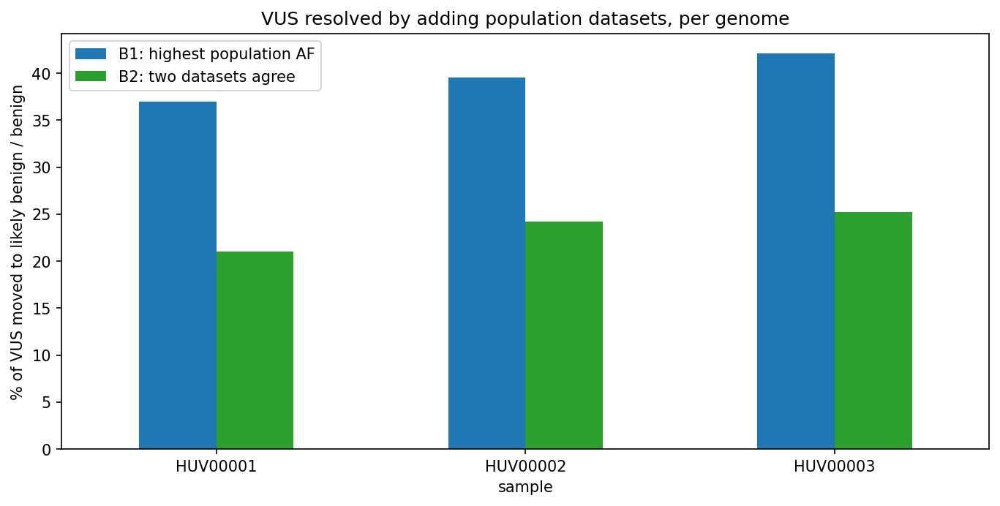

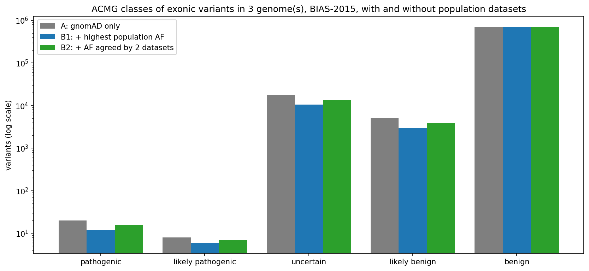

### Limitations of these analyses

- Exonic variants only (the kept table); deep-intronic pathogenic alleles are not counted.
- ClinVar is biased towards well-studied, mostly European populations; carrier and founder estimates for other
  populations are lower bounds.
- Carrier frequencies assume Hardy–Weinberg proportions; consanguinity increases the expected number of affected births.
- The ACMG comparison uses three genomes; a larger patient cohort is needed to generalise the numbers.
- The ancestry panel is untested on genotypes.

## Comparison with the Pakistan Genome Resource

Koch C, Khalid S, Khan MZ, *et al.* Analysis of 173,303 exomes and genomes in the Pakistan Genome Resource.
*Nature* 656, 670–679 (2026). https://doi.org/10.1038/s41586-026-10667-5

### The study in brief

- 173,303 participants from 23 cities in Pakistan: 166,625 exomes and 6,678 genomes; high autozygosity (30.6% report
  first-cousin parents; mean F<sub>ROH</sub> 0.034).
- 6,625,995 coding variants; 1,974,277 (30%) absent from all of gnomAD v4.1 and 3,113,192 (47%) absent from gnomAD's
  non-South-Asian groups. Absence rises from synonymous (25%) to missense (30%) to pLoF (49%) variants (their Table 1).
- Homozygous loss-of-function variants in 6,476 genes, 2,298 of them not seen homozygous in gnomAD; depletion of
  homozygous LoF in essential, autosomal dominant and recessive disease genes.
- Pakistani populations are genetically closer to European and Middle Eastern groups than to East Asian or African groups.

### Where the findings agree

#### 1. Under-represented populations add many variants absent from gnomAD, mostly rare

Share of coding variants absent from gnomAD v4.1, by consequence (PGR: paper Table 1, all of gnomAD, MAC ≥ 1;
this study: exonic variants of protein-coding genes per dataset; `results/09_pgr_comparison/`).

| Dataset | Synonymous | Missense | In-frame | pLoF | pLoF / synonymous |
|---|---:|---:|---:|---:|---:|
| **PGR (Pakistan)** | **24.9%** | **30.3%** | **35.5%** | **48.7%** | **1.96** |
| ToMMo (Japan) | 26.2% | 34.0% | 45.8% | 55.3% | 2.11 |
| All of Us | 20.6% | 25.1% | 32.1% | 39.7% | 1.93 |
| MCPS (Mexico) | 19.6% | 25.2% | 29.9% | 44.0% | 2.24 |
| WBBC (China) | 18.5% | 21.3% | 22.6% | 37.2% | 2.01 |
| KOVA (Korea) | 14.6% | 18.9% | 25.7% | 36.8% | 2.52 |
| SG10K (Singapore) | 12.9% | 16.8% | 19.2% | 31.1% | 2.41 |
| TOPMed | 12.8% | 15.7% | 19.0% | 25.5% | 1.99 |
| GME (Middle East) | 10.8% | 17.5% | 9.4% | 33.9% | 3.13 |
| Saudi | 3.6% | 8.0% | — | 15.4% | 4.30 |
| SweGen (Sweden) | 2.0% | 3.5% | 4.6% | 9.4% | 4.64 |
| GoNL (Netherlands) | 3.2% | 6.0% | 4.5% | 15.0% | 4.74 |

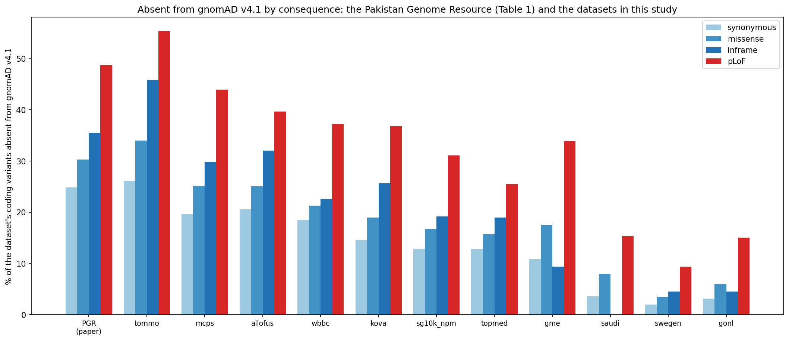

- **Same gradient everywhere.** In every dataset, as in PGR, the share absent from gnomAD rises from synonymous to
  missense to pLoF: damaging alleles are rarer (purifying selection) and so less often already catalogued.
- **Same magnitude for large cohorts of under-represented populations.** PGR's 25% synonymous / 49% pLoF sits with
  ToMMo, MCPS, All of Us and WBBC (19–26% / 37–55%), with pLoF:synonymous ratios of 1.9–2.2 (PGR 1.96).
- European cohorts (SweGen, GoNL), well covered by gnomAD, add far less (2–3% synonymous). Small cohorts have higher
  ratios (Saudi, SweGen, GoNL ≥ 4) because the few variants they contribute beyond gnomAD are mostly rare damaging ones.

#### 2. Population structure

The paper places Pakistani populations closer to European and Middle Eastern groups than to East Asian or African
groups. Our mean absolute AF differences (exonic SNVs) agree for gnomAD's South Asian group:

| From gnomAD SAS to | Mean \|ΔAF\| |
|---|---:|
| gnomAD AMR | 0.060 |
| gnomAD MID, gnomAD NFE | 0.067 |
| Saudi | 0.069 |
| East Asian cohorts (ToMMo, KOVA, WBBC, gnomAD EAS) | 0.101–0.105 |
| gnomAD AFR | 0.122 |

Our Middle East marker panel points the same way: its closest other group is most often NFE, then AMR, AFR and SAS,
with EAS least often.

#### 3. Consanguineous populations are where population-specific clinical variation concentrates

The paper's homozygous loss-of-function discovery rests on high autozygosity. In our data, the consanguineous Middle
Eastern datasets carry the strongest population-specific clinical signal: GME is the only dataset adding substantial
common coding variation beyond gnomAD (7.5% of common exonic SNVs), it takes part in 17 of the 32 high-confidence
founder pathogenic variants, and it has among the highest carrier burdens (for example PAH 4.3%).

#### 4. A national resource is needed for clinical interpretation

The paper presents PGR as a reference for clinical variant interpretation in South Asia. Our ACMG test shows why such
resources matter: adding population frequencies to gnomAD moves 21–37% of one genome's VUS to (likely) benign.

### What the two studies cannot compare

- **Rare vs common.** PGR reports absence from gnomAD for all variants (46% are singletons). Our step 1 also separates
  common variants: for most datasets, common exonic SNVs are almost all already in gnomAD (< 0.5%). PGR does not report
  an AF-stratified figure, so whether its common variants are equally well covered by gnomAD's SAS group is open.
- **Genotype-level results.** Homozygous LoF counts, autozygosity and recall-by-genotype need individual genotypes; our
  study uses summary frequencies only.
- **South Asia is our main gap.** IndiGen (no frequencies) and GenomeAsia (unreliable) were excluded, so our only
  South Asian information is gnomAD SAS and the Indian part of SG10K. Adding PGR summary frequencies, if released,
  would fill it.

### Conclusion

The Pakistan Genome Resource and this multi-population study agree on the pattern (more damaging variants are less
often in gnomAD), on its size for large under-represented cohorts, on population structure, and on the value of
national resources for consanguineous, under-represented populations. They are complementary: PGR adds individual-level
homozygosity, and this study adds the common-variant view across 27 datasets and the clinical frequency checks.

## Limitations and publication

### Limitations

- **Summary data only.** Allele frequencies, not genotypes: no per-person burden, linkage, relatedness or haplotype
  analysis.
- **Heterogeneous technologies.** Imputed arrays, exomes, short- and long-read genomes, each with its own QC and calling.
  Some differences between datasets reflect technology rather than population (for example long-read cohorts in hard
  regions, imputed cohorts for indels).
- **Third-party conversions.** Several datasets came through ANNOVAR liftovers from hg19 or UCSC conversions; the errors
  found are documented in the [data-quality audit](sections/03_data_quality_audit.md), and others may remain.
- **gnomAD exome and genome not combined by allele number.** The ANNOVAR tables carry AF only, so a joint AF could not be
  computed; the exonic/non-exonic split avoids mixing them.
- **Small cohorts.** Saudi (~300), GoNL (498), GA4K (~550) and SVatalog (101) give noisy frequencies.
- **Region coverage.** No Iranian cohort was included; GME covers the Middle East only partly and has indel quality
  problems.
- **Gene level.** Without a mutation-rate model the comparison is relative to gnomAD, not to an absolute expectation.
- **Additional analyses.** Exonic variants only; ClinVar is biased towards well-studied populations, so founder and
  carrier estimates for other populations are lower bounds; carrier frequencies assume random mating; the ACMG
  comparison uses three genomes; the ancestry panel is untested on genotypes.

### Publication assessment

The study can be presented as a conference abstract now and developed into a journal paper with additions.

**Strengths**

- Scale: 27 datasets, 2.06 billion variants, exonic and non-exonic analysed separately, both directions of disagreement.
- A practical, actionable answer for diagnostic labs: filter on the gnomAD population maximum; add GME for Middle Eastern
  patients; add genome cohorts outside exons.
- A systematic audit of errors in widely used public frequency tracks.
- A clinical angle (ACMG BA1/BS1/PM2) with a replication rule for frequency evidence.

**Needed for a journal paper**

1. A sharper novelty: comparisons of single national databases with gnomAD exist. The strongest angles here are the
   Middle East gap, the error audit, and the popmax rule.
2. An Iranian or Middle Eastern cohort (e.g. Iranome or in-house exomes) to make the Middle East result the centrepiece.
3. Quantified clinical impact on a patient cohort. A test on three genomes is done (23.6–39.7% of VUS resolved,
   [Additional analyses](sections/07_additional_analyses.md#6-acmg-reclassification-in-real-genomes)); a larger cohort is needed.
4. Sensitivity analyses: frequency thresholds, minimum allele number, with and without imputed cohorts.

**Possible venues**

| Venue type | Examples | Status |
|---|---|---|
| Conference | ASHG or ESHG annual meeting (abstract) | Ready with current results |
| Human genetics journal | European Journal of Human Genetics, Human Genetics, Human Genomics, Genetics in Medicine Open | After the additions above |
| Resource or methods journal | NAR Genomics and Bioinformatics, BMC Genomics, Database | If the harmonised union and quality flags are released |

### Data use

No input data are redistributed in this repository. Before releasing any derived per-variant file (for example the
union table), check the terms of each source: gnomAD (open), UK Biobank, All of Us (data and statistics dissemination
policy), FinnGen, ToMMo, TOPMed/BRAVO, SPARK/SFARI, and ANNOVAR's database licence (free for non-commercial use).

## Further analyses

Analyses that would add value for clinical and population geneticists, roughly in order of value for effort. Each can
reuse the union, the harmonised per-dataset frequencies and the VEP annotation built here.

**Done** (see [Additional analyses](sections/07_additional_analyses.md)): founder and population-enriched pathogenic variants
(item 5), carrier frequencies (item 4), the "do not trust the frequency" gene and region list (item 7), candidate
ancestry-informative markers (item 10, selection only), and an ACMG reclassification test on three genomes (item 2).
**Need the raw frequency files** (AC, AN or homozygote counts were not kept): items 3 and 8, and the non-coding parts of
items 6 and 9.

### High value

1. **Iranian / Middle Eastern focus.** Add Iranome and in-house Iranian exomes. Repeat steps 1–4 with the Middle East as
   the target population: how many common Iranian variants are rare or absent in gnomAD, GME and Saudi, and how the
   three overlap.
2. **ACMG reclassification impact in real patients.** Annotate a set of patient exomes with gnomAD only, then with gnomAD
   plus the population datasets, and count variants whose BA1, BS1 or PM2 status changes, and whose final class changes.
   Use ClinGen expert-panel gene-specific thresholds where they exist, and the maximum credible population AF (from
   disease prevalence, penetrance and genetic heterogeneity) for BS1.
3. **Filtering allele frequency with confidence intervals.** Most datasets give AC and AN. A 95% Poisson/binomial upper
   bound ("FAF95") per dataset and population would make small cohorts usable for BS1/BA1 without over-trusting them, and
   would replace the fixed AN ≥ 100 rule.
4. **Carrier frequencies for recessive disorders.** Sum the frequencies of ClinVar P/LP (and high-confidence LoF) alleles
   per gene and population to estimate carrier rates and expected affected births, especially for populations with high
   consanguinity. Output: population-specific carrier-screening gene lists.
5. **Founder and population-enriched pathogenic variants.** ClinVar P/LP variants at least 10-fold more frequent in one
   population than in gnomAD's popmax, supported by two datasets, focusing on ACMG secondary-findings genes and newborn
   screening genes.

### Medium value

6. **Pharmacogenomics.** Frequencies of CPIC/PharmGKB actionable alleles (CYP2C19, CYP2D6-tagging SNVs, DPYD, TPMT,
   NUDT15, SLCO1B1, HLA-tagging SNVs) per population, against gnomAD, to show where gnomAD-based dosing assumptions fail.
7. **A curated "do not trust the frequency" resource.** Combine the shared gene outliers from the gene step, the
   single-dataset ClinVar artefacts, and known difficult regions (segmental duplications, GIAB stratifications) into a
   BED and gene list for variant-interpretation pipelines; validate against GIAB truth sets.
8. **Homozygote evidence.** Many datasets give homozygote counts (nhomalt, AC_Hom, HomC). Healthy homozygotes for a
   variant in a recessive gene are evidence against pathogenicity (ACMG BS2); compare homozygote counts across populations.
9. **Non-coding functional variants.** Repeat the "common locally, rare in gnomAD" analysis for splice-altering
   (SpliceAI), UTR and promoter variants, where gnomAD's genome set is smallest.
10. **Ancestry-informative markers for the region.** Select markers from step 3 to build a compact panel distinguishing
    Middle Eastern sub-populations, and test it on HGDP and in-house samples.

### Lower priority or out of scope

- Population-specific gene constraint (observed/expected with a mutation-rate model): needs genotype-level data and
  coverage per dataset to be reliable.
- Structural variants (gnomAD-SV against long-read and national SV catalogues).
- Cross-build (GRCh37/GRCh38) liftover error rates, using the hg19-lifted tables (gnomAD v2, ExAC, Kaviar) as test cases.

## Data manifest

What the study read, what it produced, and what is kept after the raw inputs are deleted.

### Raw inputs (deletable; all can be downloaded again)

Sizes and dates as on the analysis server, 24 November 2026.

#### ANNOVAR tables (`/home/NASER/annotation/population_study/data/raw/annovar_popfreq/`, 233 GB)

| File | Size | Date | Re-download |
|---|---:|---|---|
| `hg38_gnomad41_genome.txt` (+ `.idx`) | 102.5 GB | 2024-06-02 | `annotate_variation.pl -buildver hg38 -downdb -webfrom annovar gnomad41_genome humandb/` |
| `hg38_allofus.txt` (+ `.idx`) | 85.5 GB | 2025-03-14 | `… -downdb -webfrom annovar allofus` |
| `hg38_gnomad41_exome.txt` (+ `.idx`) | 18.6 GB | 2024-05-31 | `… gnomad41_exome` |
| `hg38_gnomad_genome.txt` (+ `.idx`) | 17.1 GB | 2019-12-06 | `… gnomad_genome` |
| `hg38_kaviar_20150923.txt` (+ `.idx`) | 12.2 GB | 2019-12-06 | `… kaviar_20150923` |
| `hg38_ALL.sites.2015_08.txt` and AFR, AMR, EAS, EUR, SAS | 9.0 GB | 2015-08-26 | `… 1000g2015aug` |
| `hg38_gnomad_exome.txt` (+ `.idx`) | 1.1 GB | 2019-12-06 | `… gnomad_exome` |
| `hg38_exac03.txt` (+ `.idx`) | 0.6 GB | 2019-12-06 | `… exac03` |
| `hg38_gme.txt` (+ `.idx`) | 0.07 GB | 2019-12-06 | `… gme` |

#### UCSC varFreqs (`/home/NASER/annotation/population_study/data/raw/ucsc_varfreqs/`, 122 GB)

Base URL: `http://hgdownload.soe.ucsc.edu/gbdb/hg38/varFreqs/` (each VCF with its `.tbi`). Script: `scripts/get_ucsc_missing.sh`.

| File | Size | Notes |
|---|---:|---|
| `varFreqsAll/varFreqsAll.bb` | 30.3 GB | Last modified at UCSC 2026-01-20; 1,259,969,871 records |
| `varFreqsAll/varFreqsAll.tsv.gz` (+ `.tbi`) | 25.2 GB | Derived: `bb_to_table.sh` + `fix_bb_header.sh` |
| `gregor/gregor.vcf.gz` | 20.6 GB | |
| `npm/SG10K_Health_r5.3.2.sites.vcf.bgz` | 17.6 GB | |
| `hgdp1kFreq/hgdp1k.freq.vcf.gz` | 15.9 GB | |
| `hostseq/hostseq.vcf.gz` | 9.5 GB | |
| `alfa/ALFA.vcf.gz` | 2.8 GB | |
| `wbbc/wbbc.vcf.gz` | 2.2 GB | |
| `sgdpFreq/sgdp.freq.vcf.gz` | 2.0 GB | In the union only |
| `gonl/gonl.vcf.gz` | 1.7 GB | |
| `colorsDb/colorsDbSnv.vcf.gz` | 0.7 GB | |
| `ukbb/ukbb.vcf.gz` | 0.55 GB | |
| `schema/SCHEMA_variant_results_withAF.vcf.gz` | 0.54 GB | In the union only |
| `ga4k/ga4kSnv.vcf.gz` | 0.54 GB | |
| `svatalog/svatalog.vcf.gz` | 0.18 GB | |

#### Intermediate files (deletable)

| Location | Size | Content |
|---|---:|---|
| `/home/NASER/annotation/population_study/data/work/freq_union/hg38_freq_union.txt` (+ `.idx`) | 102 GB | Uncompressed union; a compressed copy is kept (below) |
| `/home/NASER/annotation/population_study/data/work/gene_burden/{split,vep,annot,work}` | ~104 GB | Gene-step intermediates; the annotated variant list is kept compressed (below) |

**Before deleting `annovar_popfreq/`:** `/root/naser/annotation/annovar/humandb/` holds symbolic links to these tables.
ANNOVAR runs that use `gnomad41_exome`, `gnomad41_genome`, `allofus`, `kaviar_20150923`, `exac03`, `gme`, `gnomad_exome`,
`gnomad_genome` or `1000g2015aug` from that folder will stop working.

### Kept results

#### In this repository

`results/` (tables and figures for both regions and the gene level), `results/02_frequency_vs_gnomad/supplementary/` (per-variant exonic markers
and ClinVar matches), `docs/`, `report/`, `scripts/`.

#### On the server: `/home/NASER/annotation/population_study/data/archive/`

| Path | Content |
|---|---|
| `union/hg38_freq_union.txt.gz` (+ `.tbi`) | The union: 2,055,347,367 variants with `is_in` and `how_many` (bgzip, tabix-indexed) |
| `union/summary_*.tsv`, `run.log` | Variants per dataset, per number of datasets, per dataset combination |
| `study/{exonic,non_exonic}/` | `counts.tsv`, per-variant `markers.tsv.gz`, `clinvar_candidates.tsv.gz`, `clinvar_hits.tsv.gz`, `pca_snvs.tsv.gz`, all tables and figures |
| `study/regions/` | gnomAD v4 exome calling intervals used for the split |
| `study/extraction_stats.tsv`, `run.log` | Rows kept and dropped per source |
| `gene_level/exonic_variants_annotated.tsv.gz` | Every exonic variant: gnomAD AF, AF in each dataset, VEP consequence, gene, MANE |
| `gene_level/gene_counts.tsv.gz`, `gene_length.tsv` | Per gene × dataset counts and gene footprints |
| `gene_level/tables/` | Including the two full per-gene tables not stored in this repository |
| `clinvar_20261115.vcf.gz` (+ `.tbi`, `.md5`) | ClinVar release used |

#### Additional analyses: `/home/NASER/annotation/population_study/data/work/extra_analyses/`

One folder per analysis (`founder_variants`, `carrier_frequency`, `unreliable_regions`, `ancestry_markers`,
`acmg_impact`, `pgr_comparison`), each with `tables/` and `figures/`; `shared/` holds the ClinVar P/LP table with
population and gnomAD group AFs; `acmg_impact/<sample>/` holds each genome's VEP JSON and three BIAS outputs, and
`acmg_impact/inputs/` the copies of the HUV00002 and HUV00003 genome VCFs (copied read-only from the HUVYA WGS output).
Keep `extra_analyses/acmg_impact/inputs/` if you want to rerun the ACMG stage.

With these files every table and figure can be regenerated without the raw inputs (`freq_study_report.py`,
`gene_burden_report.py`, `make_results_md.py`). Re-running harmonisation, extraction or the union needs the raw inputs again.

## Reproducibility protocol

How to regenerate every result in this repository, either from the kept archive (no raw files needed) or from scratch
(re-downloading the raw frequency files). Everything runs through one driver:

```bash
bash scripts/run_all.sh <stage> [<stage> ...]
```

Paths and settings are in [`scripts/config.sh`](../scripts/config.sh); each stage logs to `$DATA/logs/<stage>.log`.

### 1. Two ways to regenerate

| Route | Needs | Stages | Time (192-core server) | Regenerates |
|---|---|---|---|---|
| **From the kept archive** | `$KEEP` (≈ 21 GB), the reference resources in section 3 | `all-kept` = `extra reports` (+ `acmg`) | ≈ 3 h (+ 20 min) | All tables, figures and documents; all additional analyses |
| **From scratch** | Internet access, ≈ 600 GB free disk, section 3 | `all-raw` = `download prepare union study clinvar gene keep extra reports` | ≈ 12 h (downloads excluded) | Everything, including the union, the harmonised per-dataset frequencies and the kept archive |

The kept archive (`/home/NASER/annotation/population_study/data/archive/`) is what remains after the raw frequency files are
deleted. Its content and checksums are listed in [Data manifest](sections/06_data_manifest.md) and `results/00_provenance/kept_archive.md5`.

### 2. Software

| Software | Version used | Where |
|---|---|---|
| bash, GNU awk, GNU coreutils (sort) | bash 5, gawk 5.1.1, coreutils 9.0 | system |
| bcftools, tabix, bgzip (htslib) | 1.19 | system (`/usr/local/bin`) |
| bedtools | 2.x | system |
| UCSC bigBedToBed, bigBedInfo; aria2 | 482; 1.37.0 | conda env `ucsc` (bioconda, conda-forge) |
| Python with pandas, NumPy, SciPy, matplotlib | 3.10.22; 2.2.2, 1.26.4, 1.14.1, 3.10.9 | conda env `ahm-env` (`$PY`) |
| Ensembl VEP | 116.3 (API 116), Docker image `huvya/vep:116`, `sha256:b8901bb319b3…` | Docker |
| ANNOVAR `annotate_variation.pl` | 2025-03-02 | `$ANNOVAR` (needed only for `download`) |
| BIAS-2015 | git commit `290b99a`, plus `scripts/analyses/bias_pm4_length_chrM.patch` | `$BIAS` (read-only) |

To rebuild the conda environments elsewhere:

```bash
conda create -n ucsc -c conda-forge -c bioconda ucsc-bigbedtobed=482 ucsc-bigbedinfo=482 aria2
conda create -n popfreq -c conda-forge python=3.10 pandas=2.2 numpy=1.26 scipy=1.14 matplotlib=3.10
```

### 3. Reference resources (not deleted with the raw files)

| Resource | Path (config variable) | Used by |
|---|---|---|
| VEP 116 RefSeq cache with gnomAD v4.1 AFs | `/home/NASER_FILES/Naser_VEP/vep_cache` (`VEP_CACHE`) | gene step (indels), ClinVar P/LP group AFs, ACMG |
| VEP annotation of every possible exonic SNV (CADD v1.7 exon set) | `$VEP_ROOT/results/CADD_exons_merged_64cpu/…vep.tsv.gz` (`CADD_VEP_TSV`) | gene step (SNV lookup) |
| hg38 FASTA | `/home/NASER_FILES/annovar/hg38/reference/hg38.fa` (`FA`) | VEP |
| BIAS-2015 data (hg38, 2026-10-15), REVEL, AlphaMissense, ClinVar 2026-10-11 | `/home/NASER/annotation/acmg` (`ACMG`) | ACMG, ClinGen AR genes |
| BIAS-2015 code | `/root/naser/annotation/acmg/BIAS-2015` (`BIAS`) | ACMG |
| Patient genome | `$VEP_ROOT/results/HUV00001_refseq_32cpu/HUV00001.norm.vcf.gz` (`VCF`) | ACMG |
| GIAB v3.5 GRCh38 stratifications | downloaded by the `extra` stage | unreliable regions |

Nothing under `/home/HUVYA` is used. The published gene step used the HUVYA merged VEP cache (read-only); the default
is now the `Naser_VEP` RefSeq cache, which can pick a different transcript for a small share of variants.

### 4. Raw inputs (the `download` stage)

| Source | What | Exact identity |
|---|---|---|
| ANNOVAR | `gnomad41_exome`, `gnomad41_genome`, `gnomad_exome`, `gnomad_genome`, `kaviar_20150923`, `exac03`, `1000g2015aug`, `gme`, `allofus` (hg38) | file sizes and dates in [Data manifest](sections/06_data_manifest.md); MD5 in `results/00_provenance/raw_inputs.md5` |
| UCSC varFreqs | `varFreqsAll.bb` (30,276,835,043 bytes, modified 2026-01-20) and 13 cohort VCFs | `http://hgdownload.soe.ucsc.edu/gbdb/hg38/varFreqs/`; MD5 in `results/00_provenance/raw_inputs.md5` |
| gnomAD | v4 exome calling intervals `ukb.pad50.broad.pad50.union.intervals` | `GNOMAD_INTERVALS_URL` in `config.sh` |
| ClinVar | `clinvar_20261115.vcf.gz` (GRCh38) | NCBI archive URL in `config.sh`; MD5 checked on download |

Public resources change: UCSC and ANNOVAR replace files in place. After `download`, the driver compares every file
with `raw_inputs.md5` and reports whether the inputs are identical to the published run. If they differ, the results
can differ too; keep the kept archive as the reference.

### 5. Stages

| Stage | Script(s) | Output | Time | Check |
|---|---|---|---|---|
| `download` | ANNOVAR `-downdb`, `get_ucsc_missing.sh`, `curl` | `$ANNOVAR_TABLES`, `$UCSC_DIR`, `$CLINVAR`, `$INTERVALS` | hours (network) | log says "raw inputs identical to the published run" |
| `prepare` | `bb_to_table.sh`, `fix_bb_header.sh` | `varFreqsAll.tsv.gz` (+ `.tbi`) | ≈ 1.5 h | 1,259,969,871 rows = `bigBedInfo` itemCount |
| `union` | `freq_union.sh` | `hg38_freq_union.txt` (+ `.idx`, summaries) | ≈ 5 h | 2,055,347,367 variants |
| `study` | `freq_study.sh` | `exonic/`, `non_exonic/` counts and per-variant files | ≈ 1.7 h | 293,015,270 exonic and 3,917,707,046 non-exonic dataset alleles classified |
| `clinvar` | `freq_clinvar.sh`, `freq_study_report.py` | ClinVar matches, tables, figures | ≈ 20 min | — |
| `gene` | `freq_study.sh` (`DUMP=1`), `snv_annot.sh`, `gene_burden.sh`, `gene_burden_report.py` | per-gene counts, gene tables and figures | ≈ 3.5 h | 106,845,209 SNVs by lookup + 89,022,055 by VEP = 195,874,106; no "without VEP annotation" warning |
| `keep` | `make_keep.sh` | `$KEEP` + `provenance/*.md5` | ≈ 1 h | `KEEP_DONE` in the log |
| `extra` | `extra/*` (except ACMG) | `$EXTRA_DIR/<analysis>/{tables,figures}` | ≈ 70 min | numbers in section 6 |
| `acmg` (optional) | `extra/acmg_impact.sh`, `extra/acmg_compare.py` | `$EXTRA_DIR/acmg_impact` | ≈ 20 min for 3 genomes | numbers in section 6 |
| `reports` | `freq_study_report.py`, `gene_burden_report.py` on `$KEEP`; copy; `make_results_md.py`; `build_report_md.sh` | `results/`, `reports/sections/02_results.md`, `reports/population_frequency_report.md` | ≈ 1 h 50 min (the gene-level binomial tests take most of it) | `git diff --stat results/` shows no numeric change |

### 6. Reference values to check a re-run against

| Quantity | Value |
|---|---:|
| Union variants | 2,055,347,367 |
| ToMMo common exonic SNVs absent from gnomAD (AF ≥ 1%) | 0.31% |
| GME common exonic SNVs absent from gnomAD | 7.46% (7,363) |
| TOPMed common non-exonic SNVs absent from gnomAD | 7.65% |
| Exonic ClinVar P/LP flags: total / supported by ≥ 2 datasets | 140 / 12 |
| Founder P/LP variants: enriched / replicated / high confidence | 1,621 / 61 / 32 |
| Carrier frequency CFTR in gnomAD NFE | 4.4% |
| Unreliable genes / with ≥ 2 rules | 57 / 11 |
| ACMG (three genomes): VUS resolved, B1 / B2 | 6,954 / 4,138 of 17,516 (39.7% / 23.6%) |
| PGR comparison: pLoF / synonymous ratio, All of Us | 1.93 |

### 7. Pitfalls already handled (do not undo)

| Pitfall | Where handled |
|---|---|
| ANNOVAR `.idx` bins are not in file order: slice from the smallest to the largest byte offset | `freq_study.sh` (`chunk`) |
| hg38 1000 Genomes indel alleles are encoded `<ref length><alt>` | `freq_union.sh`, `freq_study.sh` |
| UCSC ALFA indel positions are one base too far right | union: shift −1; study: ALFA SNVs only |
| `varFreqsAll.bb` column order differs from its schema | `fix_bb_header.sh` |
| GenomeAsia frequencies unreliable | excluded in `freq_study.sh` |
| Tiny allele numbers (AC = 3, AF = 1) in SPARK, ToMMo | `MINAN=100` |
| gnomAD AF = 0 means QC-failed carriers only | treated as no AF |
| gnomAD exome group AFs missing at 12–26% of common sites | genome fallback per group |
| VEP RefSeq cache is BAM-edited: needs `--fasta` | `config.sh` `FA` |
| VEP gnomAD field names are `gnomADe_<GROUP>_AF` | `prep_clinvar_plp.sh` |
| De-duplicate VEP input on the whole allele, not on position | `gene_burden.sh` |
| Single-dataset frequencies are mostly errors | replication rules in ClinVar, founder and carrier analyses |
| CFTR poly-T/TG intronic alleles inflate carrier rates | coding P/LP only in carrier analysis |

### 8. Verification done (24 November 2026)

`bash scripts/run_all.sh all-kept` was run from the kept archive on a clean copy of the repository. Every result table
under `results/` (study, gene level and additional analyses) was regenerated byte-for-byte identical; only PDF files
differ, through their embedded creation timestamps. The ACMG stage was then run separately on three genomes.

### 9. Before deleting the raw files

1. Check `$KEEP/provenance/raw_inputs.md5` and `kept_archive.md5` exist and are non-empty (they are copied to `results/`).
2. Run `bash scripts/run_all.sh all-kept` once and confirm that `git diff --stat results/` shows no numeric change.
3. Remember that `/root/naser/annotation/annovar/humandb/` holds symbolic links into `$ANNOVAR_TABLES`.
