# Results

All numbers below are generated from the tables in [`results/`](../../results) by `scripts/make_results_md.py`. Definitions of every class and view are in [Materials and methods](01_materials_and_methods.md).

## 1. The union of all datasets

The union table holds **2,055,347,367** distinct variants (hg38). 51.9% are in one dataset only, 38.5% in 2–5 datasets and 9.6% in 6 or more. The highest number of datasets sharing one variant is 32.

| Dataset | Variants in union | Only in this dataset |
|---|---:|---:|
| allofus | 1,116,475,817 | 404,818,904 |
| topmed | 868,581,653 | 148,058,026 |
| gnomad41_genome | 759,336,310 | 95,320,044 |
| gnomad_genome | 260,417,615 | 4,546,206 |
| tommo | 257,948,687 | 124,804,524 |
| hostseq | 213,382,086 | 22,454,486 |
| kaviar_20150923 | 209,955,474 | 34,648,226 |
| hgdp1kg | 188,568,310 | 2,758,263 |
| gnomad41_exome | 183,717,260 | 109,794,024 |
| sg10k_npm | 179,418,880 | 40,134,644 |
| sfari_wgs | 167,036,436 | 13,758,308 |
| alfa | 163,487,204 | 4,021,683 |
| mcps | 140,367,157 | 17,587,794 |
| gregor | 115,608,418 | 9,139,429 |
| 1000g2015aug | 84,917,695 | 92,767 |
| wbbc | 78,594,274 | 16,891,298 |
| colorsdb | 50,103,023 | 2,134,169 |
| sgdp | 45,314,671 | 1,925,062 |
| kova | 43,302,651 | 6,348,421 |
| ga4k | 36,246,689 | 547,724 |
| swegen | 35,081,565 | 1,953,889 |
| gonl | 34,803,723 | 1,296,366 |
| saudi | 25,488,981 | 1,403,252 |
| finngen | 20,005,939 | 1,199 |
| gnomad_exome | 16,997,118 | 367,560 |
| ukbb | 13,723,704 | 3,854 |
| spark_wes | 12,887,332 | 1,313,671 |
| exac03 | 10,187,785 | 9,018 |
| schema | 8,863,409 | 201,558 |
| svatalog | 8,518,326 | 59,563 |
| genomeasia | 3,383,515 | 78,535 |
| gme | 687,665 | 77,935 |

## 2. What each dataset adds beyond gnomAD v4.1 (step 1)

Share of each dataset's variants that are absent from gnomAD v4.1, for all variants and for variants with AF ≥ 1% in the dataset. Exonic: gnomAD exomes + genomes. Non-exonic: gnomAD genomes only.

### Exonic regions, SNVs

| Dataset | Variants | % not in gnomAD | Variants AF ≥ 1% | AF ≥ 1% not in gnomAD | % AF ≥ 1% not in gnomAD |
|---|---:|---:|---:|---:|---:|
| gme | 677,157 | 15.26% | 98,647 | 7,363 | 7.46% |
| gnomad_exome_v2 | 15,818,509 | 5.64% | 157,639 | 3,375 | 2.14% |
| gnomad_genome_v2 | 13,279,787 | 2.98% | 694,471 | 14,705 | 2.12% |
| exac03 | 9,497,904 | 4.90% | 167,903 | 3,499 | 2.08% |
| colorsdb | 1,936,829 | 1.99% | 593,588 | 11,748 | 1.98% |
| alfa | 10,058,751 | 6.66% | 660,045 | 12,384 | 1.88% |
| ga4k | 1,388,133 | 2.19% | 590,308 | 9,666 | 1.64% |
| svatalog | 380,907 | 1.42% | 380,907 | 5,424 | 1.42% |
| kaviar | 17,269,090 | 10.05% | 489,818 | 5,587 | 1.14% |
| 1000g2015aug | 4,970,014 | 1.32% | 632,378 | 6,863 | 1.09% |
| gonl | 1,347,556 | 6.07% | 504,811 | 3,193 | 0.63% |
| gregor | 4,789,146 | 7.76% | 528,283 | 3,203 | 0.61% |
| topmed | 45,585,138 | 21.09% | 776,783 | 2,917 | 0.38% |
| tommo | 11,924,498 | 38.08% | 384,477 | 1,193 | 0.31% |
| allofus | 58,612,458 | 32.28% | 623,931 | 1,944 | 0.31% |
| saudi | 1,434,235 | 6.94% | 486,971 | 1,264 | 0.26% |
| ukbb | 782,434 | 0.18% | 420,635 | 559 | 0.13% |
| sg10k_npm | 8,943,444 | 23.10% | 459,843 | 534 | 0.12% |
| sfari_wgs | 8,391,650 | 10.53% | 511,162 | 440 | 0.09% |
| hostseq | 9,219,938 | 12.63% | 501,215 | 218 | 0.04% |
| spark_wes | 11,948,040 | 16.28% | 149,569 | 43 | 0.03% |
| swegen | 1,670,659 | 5.36% | 510,566 | 96 | 0.02% |
| kova | 2,916,020 | 19.09% | 358,150 | 78 | 0.02% |
| mcps | 11,972,559 | 23.01% | 406,055 | 92 | 0.02% |
| hgdp1kg | 7,365,030 | 1.37% | 634,696 | 1 | 0.00% |
| wbbc | 4,438,310 | 25.13% | 356,222 | 0 | 0.00% |
| finngen | 992,843 | 0.07% | 434,510 | 0 | 0.00% |

### Exonic regions, INDELs

| Dataset | Variants | % not in gnomAD | Variants AF ≥ 1% | AF ≥ 1% not in gnomAD | % AF ≥ 1% not in gnomAD |
|---|---:|---:|---:|---:|---:|
| gme | 10,508 | 25.10% | 2,467 | 652 | 26.43% |
| kaviar | 1,874,701 | 31.82% | 97,966 | 5,770 | 5.89% |
| allofus | 6,382,028 | 44.30% | 176,607 | 7,288 | 4.13% |
| colorsdb | 413,269 | 5.90% | 151,202 | 5,177 | 3.42% |
| ga4k | 329,799 | 5.81% | 164,755 | 5,494 | 3.33% |
| svatalog | 44,279 | 3.27% | 44,279 | 1,448 | 3.27% |
| 1000g2015aug | 176,805 | 2.97% | 72,478 | 2,088 | 2.88% |
| exac03 | 686,320 | 11.20% | 31,863 | 750 | 2.35% |
| ukbb | 58,581 | 2.10% | 45,840 | 1,058 | 2.31% |
| gnomad_exome_v2 | 1,171,218 | 10.63% | 28,516 | 541 | 1.90% |
| gnomad_genome_v2 | 1,615,159 | 4.78% | 155,068 | 2,664 | 1.72% |
| topmed | 4,313,850 | 27.38% | 164,285 | 1,411 | 0.86% |
| sfari_wgs | 825,642 | 14.53% | 61,031 | 444 | 0.73% |
| spark_wes | 730,650 | 25.80% | 11,304 | 79 | 0.70% |
| sg10k_npm | 733,783 | 33.54% | 42,326 | 205 | 0.48% |
| mcps | 864,826 | 32.12% | 43,467 | 179 | 0.41% |
| tommo | 900,485 | 58.67% | 25,349 | 61 | 0.24% |
| gregor | 793,497 | 8.89% | 169,703 | 411 | 0.24% |
| gonl | 287,151 | 2.76% | 126,354 | 117 | 0.09% |
| swegen | 168,975 | 6.87% | 51,125 | 28 | 0.05% |
| kova | 212,214 | 30.40% | 25,969 | 13 | 0.05% |
| hostseq | 1,185,353 | 13.59% | 134,130 | 35 | 0.03% |
| wbbc | 327,560 | 30.88% | 23,791 | 0 | 0.00% |
| hgdp1kg | 971,211 | 1.37% | 155,612 | 4 | 0.00% |
| finngen | 94,149 | 0.02% | 46,280 | 0 | 0.00% |

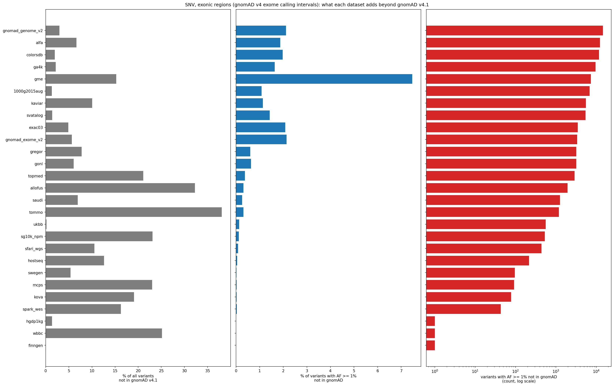

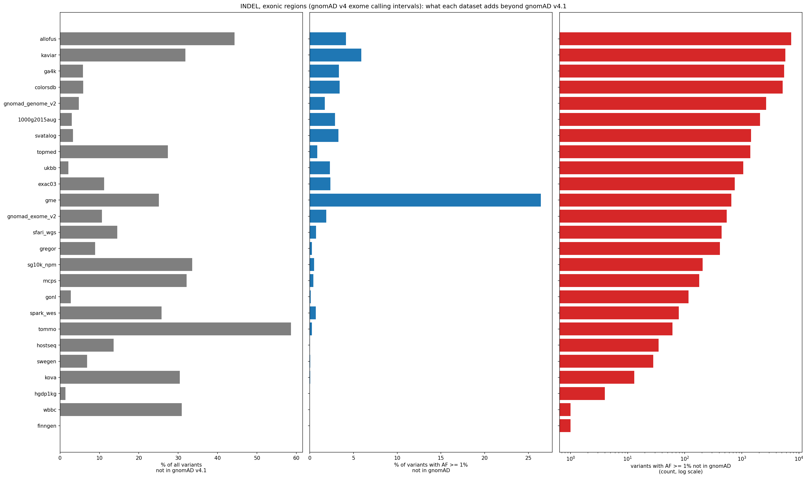

### Non-exonic regions, SNVs

| Dataset | Variants | % not in gnomAD | Variants AF ≥ 1% | AF ≥ 1% not in gnomAD | % AF ≥ 1% not in gnomAD |
|---|---:|---:|---:|---:|---:|
| colorsdb | 36,899,589 | 10.06% | 12,361,062 | 1,359,440 | 11.00% |
| topmed | 742,117,766 | 40.48% | 16,021,874 | 1,226,186 | 7.65% |
| tommo | 196,076,062 | 64.84% | 7,564,035 | 542,809 | 7.18% |
| swegen | 29,996,166 | 17.46% | 10,086,068 | 626,454 | 6.21% |
| alfa | 136,086,372 | 14.48% | 12,964,190 | 777,811 | 6.00% |
| ga4k | 26,058,276 | 6.76% | 11,617,533 | 645,590 | 5.56% |
| sg10k_npm | 149,387,922 | 45.29% | 9,487,423 | 486,046 | 5.12% |
| gonl | 24,726,537 | 14.21% | 10,102,223 | 517,618 | 5.12% |
| sfari_wgs | 141,794,374 | 24.57% | 10,199,534 | 486,383 | 4.77% |
| svatalog | 7,130,203 | 1.61% | 7,130,203 | 115,072 | 1.61% |
| kova | 37,498,359 | 35.95% | 6,595,513 | 99,389 | 1.51% |
| gnomad_genome_v2 | 213,863,282 | 5.09% | 13,127,098 | 193,831 | 1.48% |
| kaviar | 156,482,085 | 22.33% | 9,875,584 | 107,304 | 1.09% |
| 1000g2015aug | 76,455,109 | 2.04% | 12,132,466 | 99,113 | 0.82% |
| allofus | 935,654,106 | 58.23% | 12,310,970 | 92,806 | 0.75% |
| saudi | 24,054,746 | 11.34% | 8,976,432 | 30,749 | 0.34% |
| gregor | 80,225,986 | 15.34% | 10,226,966 | 25,434 | 0.25% |
| ukbb | 11,687,951 | 0.26% | 8,184,777 | 16,408 | 0.20% |
| wbbc | 68,189,102 | 43.42% | 6,668,188 | 8,569 | 0.13% |
| mcps | 116,028,585 | 35.01% | 7,962,226 | 9,465 | 0.12% |
| finngen | 17,094,529 | 0.43% | 8,329,131 | 5,692 | 0.07% |
| hostseq | 146,280,728 | 25.49% | 9,775,222 | 1,394 | 0.01% |
| hgdp1kg | 122,222,115 | 2.53% | 12,372,584 | 106 | 0.00% |

### Non-exonic regions, INDELs

| Dataset | Variants | % not in gnomAD | Variants AF ≥ 1% | AF ≥ 1% not in gnomAD | % AF ≥ 1% not in gnomAD |
|---|---:|---:|---:|---:|---:|
| kaviar | 29,276,373 | 48.00% | 2,233,523 | 187,526 | 8.40% |
| allofus | 115,827,225 | 56.12% | 4,958,303 | 364,272 | 7.35% |
| colorsdb | 10,853,016 | 9.72% | 4,143,799 | 233,708 | 5.64% |
| ga4k | 8,470,481 | 7.36% | 4,388,251 | 210,991 | 4.81% |
| svatalog | 962,937 | 3.71% | 962,937 | 35,723 | 3.71% |
| tommo | 15,842,994 | 72.11% | 515,461 | 14,221 | 2.76% |
| sg10k_npm | 11,550,951 | 46.15% | 805,749 | 20,453 | 2.54% |
| 1000g2015aug | 3,314,343 | 3.37% | 1,539,756 | 37,266 | 2.42% |
| ukbb | 1,194,738 | 2.27% | 1,018,043 | 24,022 | 2.36% |
| topmed | 76,564,899 | 35.14% | 4,410,155 | 102,991 | 2.34% |
| sfari_wgs | 15,892,695 | 20.13% | 1,456,874 | 33,365 | 2.29% |
| swegen | 3,191,048 | 11.52% | 1,058,851 | 19,578 | 1.85% |
| gnomad_genome_v2 | 31,659,387 | 5.64% | 3,978,968 | 40,786 | 1.03% |
| mcps | 10,075,091 | 31.70% | 929,497 | 6,996 | 0.75% |
| gonl | 7,227,701 | 4.08% | 3,296,853 | 19,176 | 0.58% |
| kova | 2,676,058 | 38.81% | 461,856 | 2,544 | 0.55% |
| gregor | 19,267,808 | 10.29% | 4,936,718 | 21,172 | 0.43% |
| wbbc | 5,639,302 | 36.37% | 443,324 | 698 | 0.16% |
| hostseq | 24,463,140 | 15.76% | 3,685,637 | 1,816 | 0.05% |
| finngen | 1,788,917 | 0.11% | 952,086 | 209 | 0.02% |
| hgdp1kg | 20,972,276 | 1.49% | 4,183,712 | 90 | 0.00% |

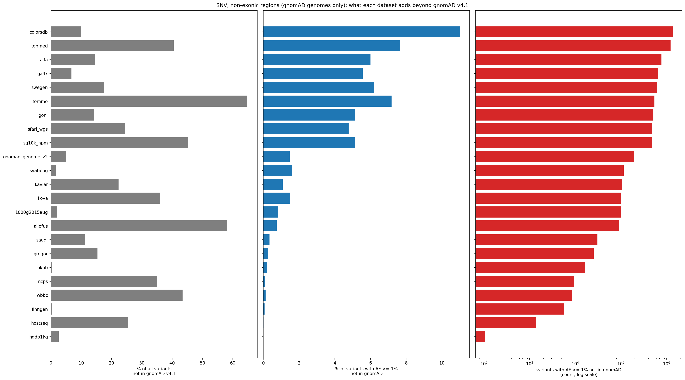

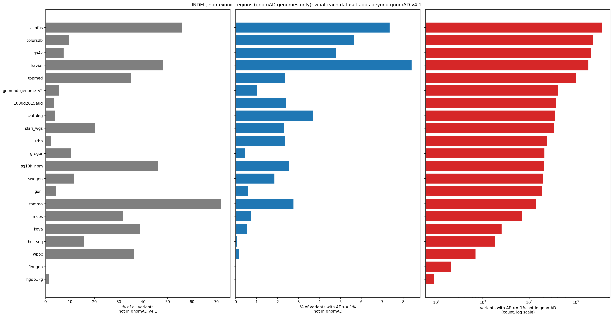

## 3. How gnomAD classifies each dataset's polymorphisms (step 2)

Of each dataset's polymorphisms (AF > 10%), the share that gnomAD calls rare (< 5%), and the share absent or QC-failed, under the three gnomAD views: overall AF, the population maximum (popmax) and the dataset's matching gnomAD group.

### Exonic

| Dataset | Type | Polymorphisms | Rare in gnomAD (overall) | Rare (popmax) | Rare (matched group) | Absent / QC fail (popmax) |
|---|---:|---:|---:|---:|---:|---:|
| FinnGen (Finland) | SNV | 236,547 | 0.80% | 0.06% | 4.05% | 0.00% |
| GME (Middle East) | SNV | 36,497 | 10.14% | 8.16% | 9.38% | 3.29% |
| GoNL (Netherlands) | SNV | 266,382 | 2.54% | 1.66% | 3.89% | 0.06% |
| KOVA (Korea) | SNV | 203,390 | 9.18% | 0.20% | 3.32% | 0.00% |
| MCPS (Mexico) | SNV | 241,011 | 6.74% | 0.35% | 2.97% | 0.01% |
| SG10K (Singapore) | SNV | 261,835 | 7.63% | 0.35% | 4.52% | 0.00% |
| Saudi Arabia | SNV | 235,199 | 3.23% | 0.19% | 4.01% | 0.00% |
| SweGen (Sweden) | SNV | 278,846 | 3.03% | 1.65% | 4.37% | 0.00% |
| ToMMo (Japan) | SNV | 218,927 | 11.65% | 1.91% | 5.72% | 0.30% |
| UK Biobank | SNV | 240,045 | 1.25% | 0.62% | 2.62% | 0.13% |
| WBBC (China) | SNV | 215,414 | 8.22% | 0.13% | 3.12% | 0.00% |
| allofus | SNV | 277,765 | 4.54% | 2.36% |  | 0.28% |
| topmed | SNV | 329,952 | 9.85% | 5.84% |  | 0.60% |
| FinnGen (Finland) | INDEL | 24,224 | 1.95% | 0.24% | 5.07% | 0.00% |
| GME (Middle East) | INDEL | 810 | 35.43% | 35.68% | 38.15% | 21.61% |
| GoNL (Netherlands) | INDEL | 44,011 | 3.88% | 1.55% | 5.94% | 0.01% |
| KOVA (Korea) | INDEL | 14,423 | 10.19% | 0.28% | 3.96% | 0.00% |
| MCPS (Mexico) | INDEL | 25,694 | 7.83% | 1.60% | 4.85% | 0.31% |
| SG10K (Singapore) | INDEL | 22,328 | 9.71% | 1.09% | 6.40% | 0.00% |
| SweGen (Sweden) | INDEL | 26,935 | 3.75% | 1.56% | 5.84% | 0.01% |
| ToMMo (Japan) | INDEL | 13,877 | 12.70% | 1.68% | 5.72% | 0.30% |
| UK Biobank | INDEL | 30,090 | 4.10% | 2.55% | 6.65% | 2.55% |
| WBBC (China) | INDEL | 9,311 | 11.78% | 0.21% | 3.79% | 0.00% |
| allofus | INDEL | 70,486 | 15.04% | 9.48% |  | 2.31% |
| topmed | INDEL | 63,310 | 9.58% | 3.74% |  | 0.64% |

### Non-exonic

| Dataset | Type | Polymorphisms | Rare in gnomAD (overall) | Rare (popmax) | Rare (matched group) | Absent / QC fail (popmax) |
|---|---:|---:|---:|---:|---:|---:|
| FinnGen (Finland) | SNV | 4,760,832 | 0.28% | 0.00% | 0.00% | 0.04% |
| GoNL (Netherlands) | SNV | 5,466,674 | 1.38% | 1.15% | 1.49% | 2.09% |
| KOVA (Korea) | SNV | 3,910,694 | 6.33% | 0.02% | 0.03% | 0.21% |
| MCPS (Mexico) | SNV | 4,884,843 | 4.62% | 0.43% | 0.73% | 0.08% |
| SG10K (Singapore) | SNV | 5,383,800 | 4.88% | 0.08% | 0.57% | 1.36% |
| Saudi Arabia | SNV | 4,609,585 | 1.30% | 0.07% | 0.36% | 0.05% |
| SweGen (Sweden) | SNV | 5,571,186 | 0.96% | 0.60% | 1.03% | 3.41% |
| ToMMo (Japan) | SNV | 4,403,575 | 7.25% | 0.97% | 1.32% | 4.30% |
| UK Biobank | SNV | 4,866,454 | 0.57% | 0.48% | 0.65% | 0.19% |
| WBBC (China) | SNV | 4,198,467 | 5.93% | 0.00% | 0.00% | 0.06% |
| allofus | SNV | 5,690,166 | 1.98% | 1.65% |  | 0.66% |
| topmed | SNV | 6,871,557 | 5.70% | 5.20% |  | 5.85% |
| FinnGen (Finland) | INDEL | 513,986 | 0.29% | 0.00% | 0.01% | 0.02% |
| GoNL (Netherlands) | INDEL | 1,109,054 | 2.78% | 2.00% | 3.04% | 0.39% |
| KOVA (Korea) | INDEL | 272,038 | 6.38% | 0.02% | 0.03% | 0.10% |
| MCPS (Mexico) | INDEL | 555,743 | 5.86% | 1.72% | 2.32% | 0.59% |
| SG10K (Singapore) | INDEL | 431,034 | 5.62% | 0.33% | 1.11% | 0.62% |
| SweGen (Sweden) | INDEL | 572,462 | 1.04% | 0.63% | 1.04% | 1.21% |
| ToMMo (Japan) | INDEL | 290,094 | 7.82% | 0.93% | 1.33% | 1.95% |
| UK Biobank | INDEL | 702,507 | 2.77% | 2.18% | 3.26% | 2.33% |
| WBBC (China) | INDEL | 167,469 | 8.84% | 0.04% | 0.06% | 0.06% |
| allofus | INDEL | 1,946,962 | 9.13% | 8.32% |  | 5.45% |
| topmed | INDEL | 1,652,173 | 3.86% | 2.93% |  | 1.89% |

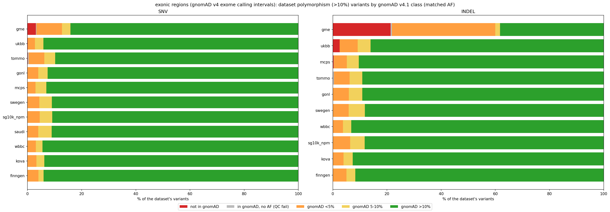

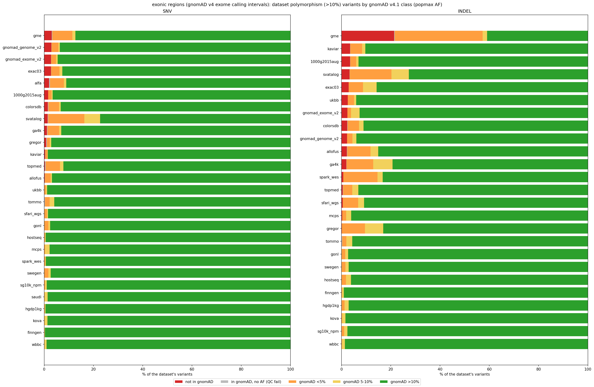

## 4. The opposite direction: rare in the dataset, polymorphic in gnomAD (step 2)

Of each dataset's rare variants (AF < 5%), the share that gnomAD calls polymorphic (> 10%).

### Exonic

| Dataset | Type | Rare variants | Polymorphic in gnomAD (overall) | Polymorphic (matched group) | Polymorphic (popmax) |
|---|---:|---:|---:|---:|---:|
| FinnGen (Finland) | SNV | 699,924 | 0.61% | 0.35% | 8.54% |
| GME (Middle East) | SNV | 628,724 | 0.07% | 0.05% | 1.70% |
| GoNL (Netherlands) | SNV | 1,013,056 | 1.02% | 0.78% | 7.74% |
| KOVA (Korea) | SNV | 2,669,448 | 1.09% | 0.12% | 2.49% |
| MCPS (Mexico) | SNV | 11,682,203 | 0.12% | 0.02% | 0.99% |
| SG10K (Singapore) | SNV | 8,624,430 | 0.31% | 0.05% | 1.28% |
| Saudi Arabia | SNV | 1,140,784 | 0.56% | 0.19% | 7.07% |
| SweGen (Sweden) | SNV | 1,325,162 | 0.52% | 0.40% | 5.60% |
| ToMMo (Japan) | SNV | 11,654,969 | 0.27% | 0.02% | 0.85% |
| UK Biobank | SNV | 486,965 | 0.75% | 0.43% | 12.19% |
| WBBC (China) | SNV | 4,180,345 | 0.72% | 0.04% | 1.85% |
| allofus | SNV | 58,259,259 | 0.01% |  | 0.14% |
| topmed | SNV | 45,155,519 | 0.02% |  | 0.17% |
| FinnGen (Finland) | INDEL | 63,475 | 2.47% | 1.31% | 13.29% |
| GME (Middle East) | INDEL | 9,304 | 0.15% | 0.11% | 1.26% |
| GoNL (Netherlands) | INDEL | 223,527 | 8.27% | 7.97% | 19.18% |
| KOVA (Korea) | INDEL | 194,511 | 1.12% | 0.12% | 2.60% |
| MCPS (Mexico) | INDEL | 833,808 | 0.31% | 0.13% | 1.62% |
| SG10K (Singapore) | INDEL | 705,511 | 0.32% | 0.06% | 1.36% |
| SweGen (Sweden) | INDEL | 135,249 | 1.65% | 1.44% | 7.29% |
| ToMMo (Japan) | INDEL | 882,999 | 0.27% | 0.04% | 0.84% |
| UK Biobank | INDEL | 22,817 | 1.98% | 0.95% | 21.31% |
| WBBC (China) | INDEL | 314,757 | 1.72% | 0.62% | 4.11% |
| allofus | INDEL | 6,286,179 | 0.21% |  | 0.56% |
| topmed | INDEL | 4,225,529 | 0.36% |  | 0.91% |

### Non-exonic

| Dataset | Type | Rare variants | Polymorphic in gnomAD (overall) | Polymorphic (matched group) | Polymorphic (popmax) |
|---|---:|---:|---:|---:|---:|
| FinnGen (Finland) | SNV | 11,270,584 | 1.36% | 0.03% | 9.19% |
| GoNL (Netherlands) | SNV | 17,829,661 | 1.55% | 0.61% | 7.61% |
| KOVA (Korea) | SNV | 32,789,173 | 1.63% | 0.05% | 3.18% |
| MCPS (Mexico) | SNV | 110,202,031 | 0.29% | 0.04% | 1.83% |
| SG10K (Singapore) | SNV | 142,668,755 | 0.37% | 0.02% | 1.32% |
| Saudi Arabia | SNV | 18,374,223 | 0.43% | 0.10% | 7.21% |
| SweGen (Sweden) | SNV | 23,087,723 | 0.82% | 0.19% | 5.41% |
| ToMMo (Japan) | SNV | 190,072,136 | 0.32% | 0.01% | 0.88% |
| UK Biobank | SNV | 5,764,033 | 2.49% | 0.06% | 16.06% |
| WBBC (China) | SNV | 63,213,030 | 0.94% | 0.01% | 2.10% |
| allofus | SNV | 928,497,626 | 0.00% |  | 0.13% |
| topmed | SNV | 733,171,965 | 0.01% |  | 0.15% |
| FinnGen (Finland) | INDEL | 1,141,854 | 1.70% | 0.07% | 12.86% |
| GoNL (Netherlands) | INDEL | 5,599,120 | 5.61% | 4.71% | 14.70% |
| KOVA (Korea) | INDEL | 2,346,094 | 1.68% | 0.06% | 3.33% |
| MCPS (Mexico) | INDEL | 9,408,659 | 0.47% | 0.11% | 2.62% |
| SG10K (Singapore) | INDEL | 11,004,729 | 0.39% | 0.02% | 1.42% |
| SweGen (Sweden) | INDEL | 2,474,476 | 0.95% | 0.25% | 6.49% |
| ToMMo (Japan) | INDEL | 15,457,587 | 0.33% | 0.03% | 0.91% |
| UK Biobank | INDEL | 372,907 | 4.55% | 0.31% | 26.25% |
| WBBC (China) | INDEL | 5,404,978 | 1.38% | 0.05% | 3.45% |
| allofus | INDEL | 113,146,837 | 0.00% |  | 0.31% |
| topmed | INDEL | 74,215,970 | 0.12% |  | 0.67% |

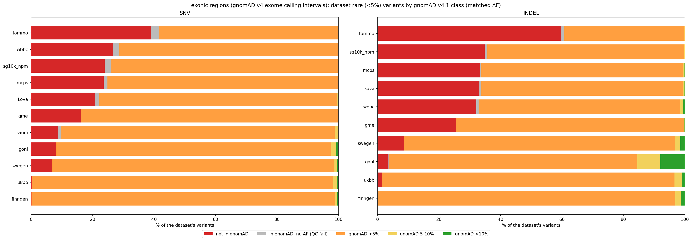

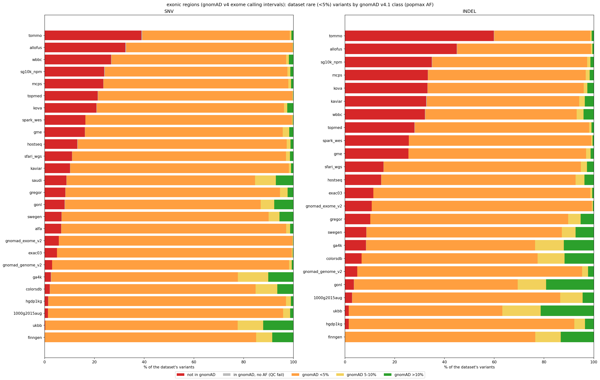

## 5. Population markers and structure (step 3)

Exonic SNVs with AF > 10% in the dataset and gnomAD popmax < 5% or absent, per country dataset:

| Dataset | Marker SNVs | Absent / QC fail in gnomAD | Rare (< 5%) in every gnomAD group |
|---|---:|---:|---:|
| ToMMo (Japan) | 4,820 | 648 | 4,172 |
| SweGen (Sweden) | 4,624 | 18 | 4,606 |
| GoNL (Netherlands) | 4,591 | 168 | 4,423 |
| GME (Middle East) | 4,179 | 1,202 | 2,977 |
| UK Biobank | 1,807 | 312 | 1,495 |
| SG10K (Singapore) | 919 | 11 | 908 |
| MCPS (Mexico) | 896 | 42 | 854 |
| Saudi Arabia | 449 | 1 | 448 |
| KOVA (Korea) | 401 | 0 | 401 |
| WBBC (China) | 271 | 0 | 271 |
| FinnGen (Finland) | 131 | 0 | 131 |

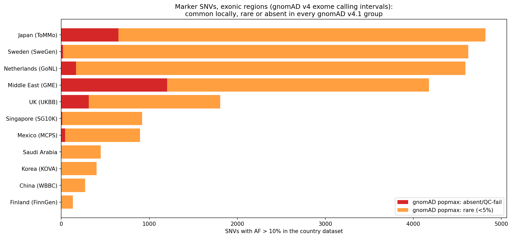

Population PCA on allele frequencies (exonic SNVs with gnomAD genome AF, AF ≥ 1% somewhere, one per 100 kb) and the mean absolute AF difference between populations:

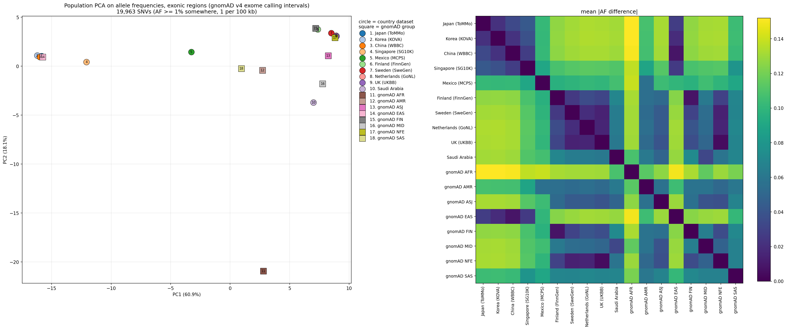

## 6. ClinVar (step 4)

ClinVar (2026-11-15) variants with AF ≥ 5% in at least one dataset and gnomAD popmax < 5% or absent, by the number of independent datasets supporting the high frequency (gnomAD v2 and ExAC counted with gnomAD).

### Exonic

| ClinVar group | 0 dataset(s) | 1 dataset(s) | 2 dataset(s) | 3 dataset(s) | 4+ dataset(s) | Total |
|---|---:|---:|---:|---:|---:|---:|
| Conflicting | 14 | 682 | 44 | 18 | 6 | 764 |
| P/LP | 1 | 127 | 9 | 1 | 2 | 140 |
| VUS | 41 | 1,261 | 129 | 37 | 36 | 1,504 |

### Non-exonic

| ClinVar group | 1 dataset(s) | 2 dataset(s) | 3 dataset(s) | 4+ dataset(s) | Total |
|---|---:|---:|---:|---:|---:|
| Conflicting | 5 | 0 | 0 | 0 | 5 |
| P/LP | 1 | 0 | 0 | 0 | 1 |
| VUS | 19 | 11 | 5 | 4 | 39 |

Exonic pathogenic / likely pathogenic variants supported by two or more datasets:

| Chr | Start | Ref | Alt | Gene | ClinVar | Stars | Max AF | gnomAD popmax | Datasets (AF) |
|---|---:|---:|---:|---:|---:|---:|---:|---:|---:|
| 19 | 1037767 | G | A | CNN2 | Pathogenic | 1 | 0.492488 | 0.0004 | gnomad_genome_v2:0.2552;tommo:0.134746;swegen:0.275;topmed:0.492488;alfa:0.2039 |
| 19 | 1037757 | G | A | CNN2 | Pathogenic | 1 | 0.491832 | 0.0008 | gnomad_genome_v2:0.2514;tommo:0.135418;swegen:0.2575;topmed:0.491832;alfa:0.3563 |
| 10 | 48066 | C | A | TUBB8 | Likely_pathogenic | 1 | 0.3585 | 0.0013 | gnomad_genome_v2:0.0591;swegen:0.3585;topmed:0.051899;alfa:0.0991 |
| 7 | 142750600 | A | T | PRSS1 | Pathogenic | 2 | 0.4751 | 2.382e-05 | gnomad_exome_v2:0.2927;gnomad_genome_v2:0.2676;exac03:0.4751;gme:0.450058;alfa:0.1841 |
| 5 | 126577145 | T | C | ALDH7A1 | Pathogenic | 2 | 0.282934 | 2.987e-05 | mcps:0.282934;alfa:0.1414 |
| 7 | 142750600 | A | C | PRSS1 | Pathogenic | 2 | 0.255 | 7.241e-05 | swegen:0.0725;gonl:0.255 |
| 14 | 77027444 | G | A | IRF2BPL | Likely_pathogenic | 2 | 0.1644 | 0 | topmed:0.0824194;alfa:0.1644 |
| 8 | 100705591 | A | G | PABPC1 | Pathogenic | 1 | 0.135585 | 0.0067 | gme:0.135585;gonl:0.053 |
| 14 | 77027450 | G | A | IRF2BPL | Likely_pathogenic | 1 | 0.132 | 4.944e-05 | topmed:0.0657195;alfa:0.132 |
| 7 | 152248171 | G | A | KMT2C | Pathogenic | 1 | 0.125926 | . | gme:0.125926;alfa:0.0898 |
| 3 | 186079931 | T | G | ETV5 | Pathogenic | 1 | 0.121628 | 0.0341 | topmed:0.121628;alfa:0.0602 |
| 13 | 20189473 | C | T | GJB2 | Pathogenic | 3 | 0.0977679 | 0.0415 | sg10k_npm:0.075807;wbbc:0.0977679 |

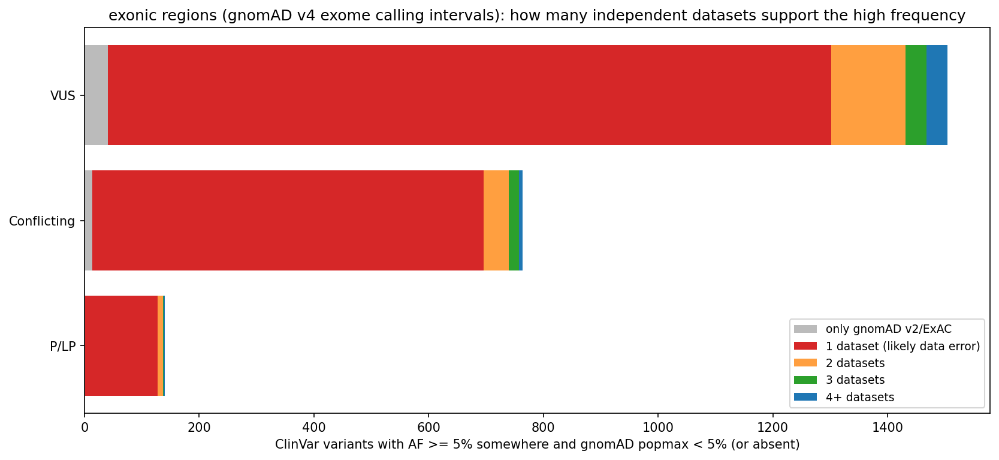

## 7. Gene level (step 5, exonic, protein-coding genes)

Genes significantly above (high) or below (low) the gnomAD expectation (FDR < 5%, ≥ 2-fold, ≥ 5 variants); PA = protein-altering, syn = synonymous (technical control), common = AF ≥ 1%.

| Dataset | PA common high | PA common low | syn common high | PA all high | PA all low |
|---|---:|---:|---:|---:|---:|
| gme | 385 | 178 | 107 | 391 | 930 |
| colorsdb | 121 | 15 | 74 | 1081 | 1038 |
| ga4k | 101 | 15 | 55 | 863 | 361 |
| alfa | 87 | 13 | 35 | 50 | 1229 |
| topmed | 84 | 3 | 48 | 14 | 380 |
| allofus | 75 | 115 | 18 | 4 | 831 |
| kaviar | 52 | 47 | 7 | 161 | 1412 |
| gnomad_genome_v2 | 51 | 23 | 19 | 108 | 904 |
| swegen | 44 | 12 | 17 | 430 | 179 |
| 1000g2015aug | 39 | 85 | 9 | 435 | 1644 |
| exac03 | 39 | 61 | 8 | 40 | 1760 |
| saudi | 35 | 163 | 6 | 548 | 406 |
| tommo | 34 | 19 | 21 | 53 | 253 |
| gnomad_exome_v2 | 33 | 46 | 10 | 39 | 954 |
| hgdp1kg | 27 | 52 | 8 | 267 | 1413 |
| svatalog | 23 | 7 | 6 | 358 | 5 |
| gonl | 20 | 25 | 2 | 419 | 266 |
| gregor | 18 | 18 | 2 | 388 | 1096 |
| sg10k_npm | 11 | 24 | 4 | 107 | 1027 |
| wbbc | 10 | 64 | 1 | 236 | 1849 |
| kova | 7 | 31 | 3 | 227 | 817 |
| hostseq | 7 | 43 | 1 | 92 | 1466 |
| sfari_wgs | 6 | 10 | 2 | 125 | 901 |
| spark_wes | 5 | 36 | 0 | 0 | 929 |
| finngen | 3 | 100 | 0 | 256 | 71 |
| mcps | 2 | 88 | 0 | 10 | 1101 |
| ukbb | 1 | 96 | 0 | 751 | 470 |

Uniqueness of genes high for common protein-altering variants:

| Pattern | Genes |
|---|---:|
| unique to one dataset | 485 |
| one population group | 129 |
| several groups | 119 |

Genes high in the most datasets:

| Gene | Datasets | Population groups |
|---|---:|---:|
| ZNF473 | 17 | Middle East,multi-population / other |
| OR6K6 | 17 | Middle East,multi-population / other |
| VCX3A | 13 | East Asia,Middle East,multi-population / other |
| LYST | 12 | Middle East,multi-population / other |
| OR4N5 | 12 | East Asia,Middle East,multi-population / other |
| VRK3 | 11 | Middle East,multi-population / other |
| ZNF729 | 9 | Europe,multi-population / other |
| PRAMEF14 | 9 | East Asia,Europe,Middle East,multi-population / other |
| MUC8 | 8 | multi-population / other |
| FAM8A1 | 8 | East Asia,Europe,Middle East,multi-population / other |
| CEACAM3 | 8 | multi-population / other |
| RHD | 8 | Middle East,multi-population / other |
| HLA-C | 8 | multi-population / other |
| MUC21 | 7 | East Asia,Middle East,multi-population / other |
| OR5H14 | 7 | multi-population / other |
| TAS2R46 | 7 | East Asia,Europe,multi-population / other |
| NBPF1 | 7 | Europe,Middle East,multi-population / other |
| NACA | 7 | East Asia,multi-population / other |
| TCHH | 7 | East Asia,multi-population / other |
| OR4C3 | 6 | Middle East,multi-population / other |
| SPATA31A7 | 6 | East Asia,Middle East,multi-population / other |
| OR4M2 | 6 | Middle East,multi-population / other |
| TAS2R30 | 6 | East Asia,Europe,multi-population / other |
| DNAH10 | 6 | Middle East,multi-population / other |
| ZNF257 | 6 | East Asia,Europe,multi-population / other |

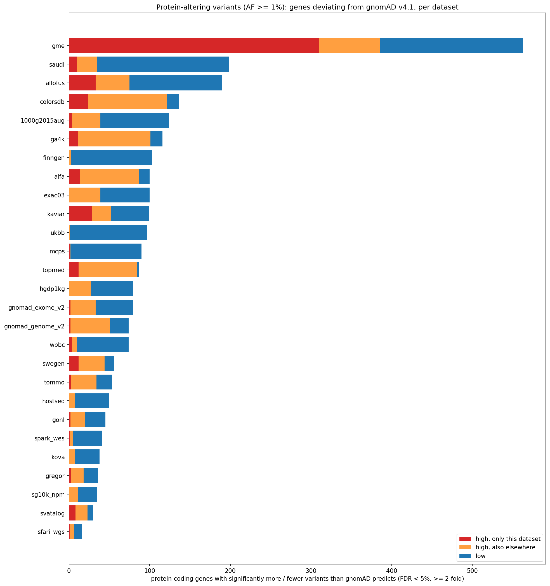

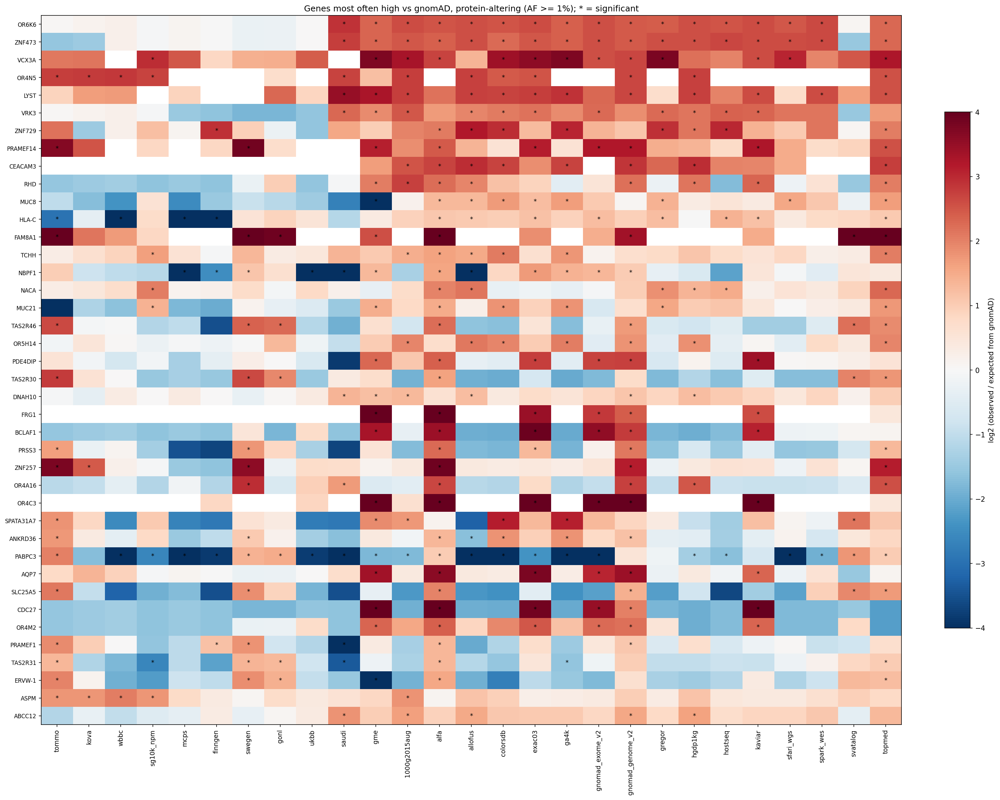

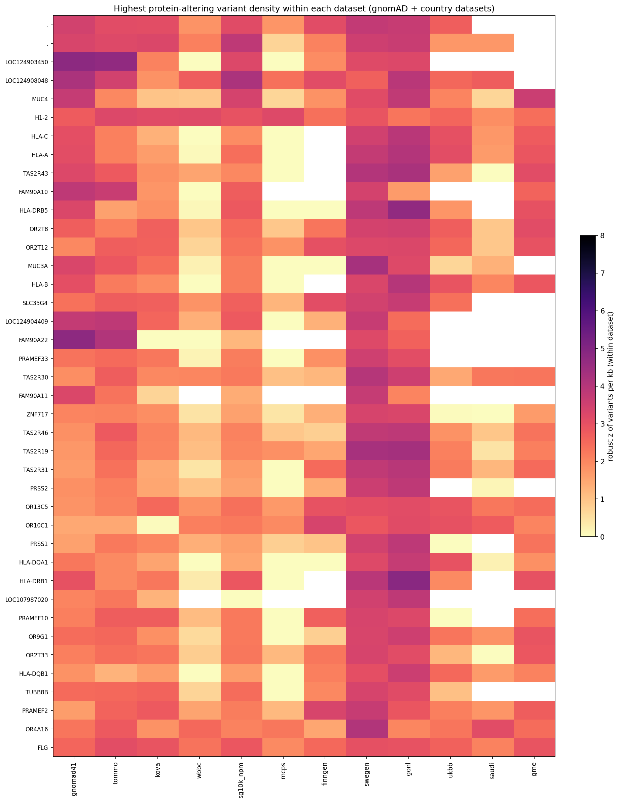
