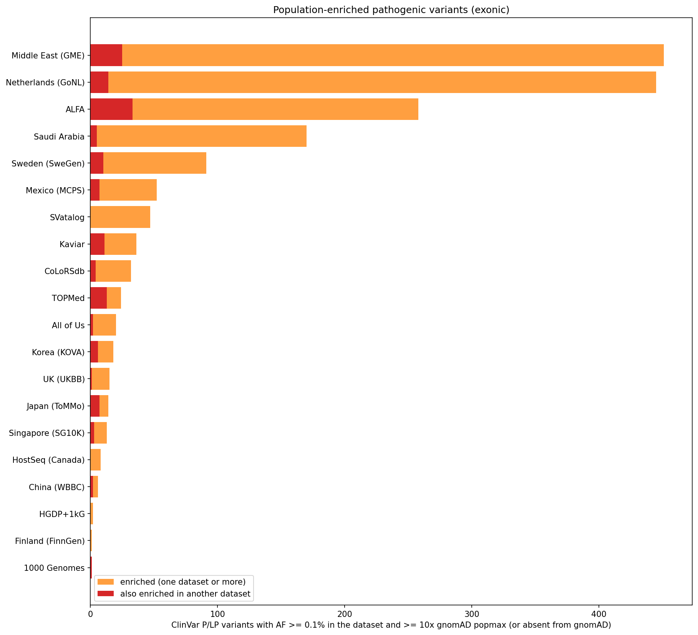
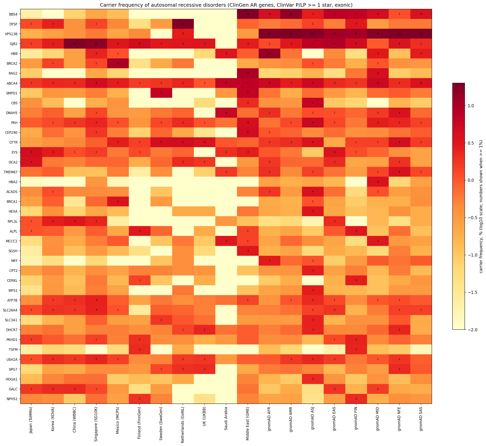
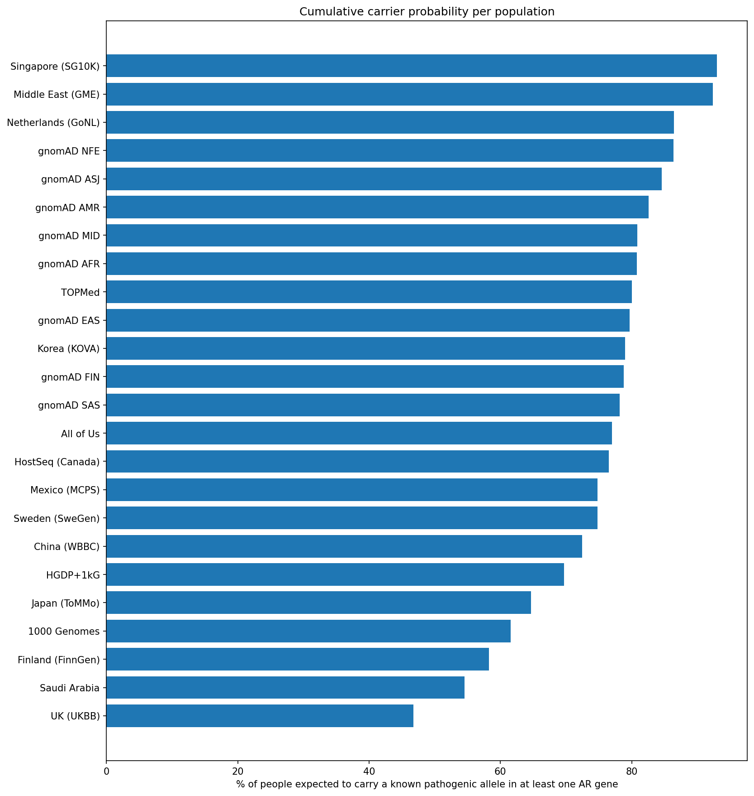
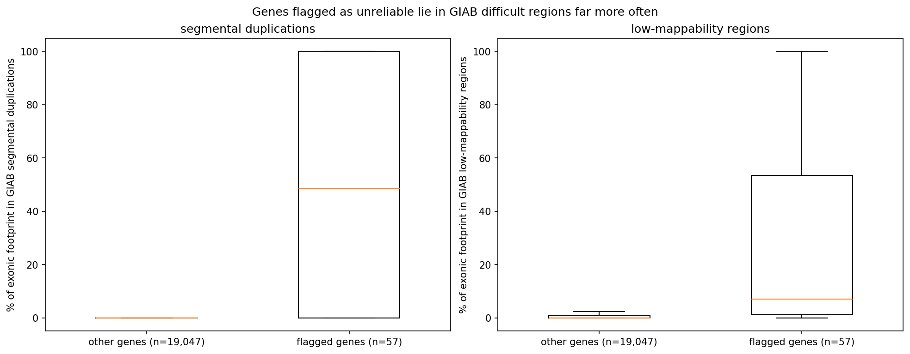
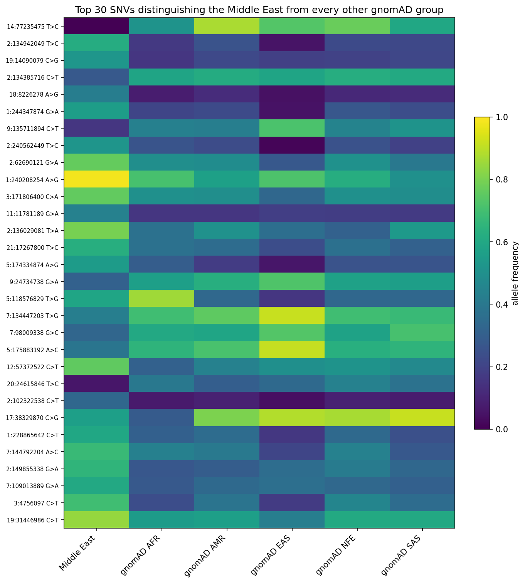
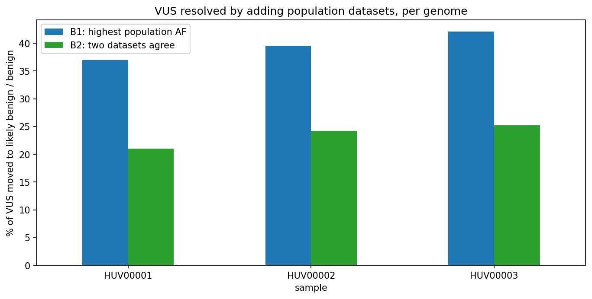
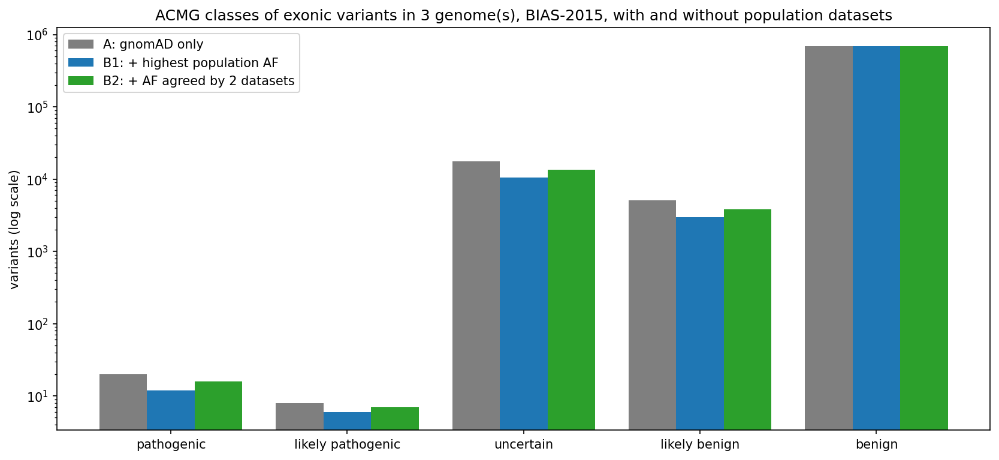

# Additional analyses

Five analyses built on the study's harmonised outputs. None of them needs the raw frequency files: they read the
kept archive (`data/archive/`: the exonic variant table with every dataset's AF, gene-level tables, PCA matrices)
and public reference data. Nothing under `/home/HUVYA` is used. Each analysis writes to its own folder
(`results/<NN_analysis>/{tables,figures}`), and its scripts are in [`scripts/analyses/`](../../scripts/analyses).

Datasets used as "population datasets" in sections 2–5: all frequency-study datasets except disease cohorts
(SPARK, SFARI WGS, GREGoR, GA4K) and earlier gnomAD releases (gnomAD v2, ExAC), which are not independent of gnomAD.

## 1. Shared input: ClinVar P/LP alleles with population frequencies

`prep_clinvar_plp.sh`

- ClinVar 2026-11-15: 367,692 records with CLNSIG starting "Pathogenic" or "Likely_pathogenic"; 367,679 normalised alleles.
- AF in every population dataset: join with the exonic variant table (155,323 P/LP alleles are exonic and seen in at least one dataset).
- gnomAD v4.1 per genetic-ancestry group (AFR, AMR, ASJ, EAS, FIN, MID, NFE, SAS), exome and genome: VEP 116 with the
  `Naser_VEP` RefSeq cache (`--af_gnomade --af_gnomadg`); group AF = exome, or genome where the exome has none;
  popmax = highest group AF.

## 2. Founder and population-enriched pathogenic variants

`founder_and_carrier.py` → `results/04_founder_variants/`

**Question.** Which ClinVar P/LP variants are much more frequent in a population than anywhere in gnomAD?

**Method.** A variant is *enriched* in a dataset when its AF there is ≥ 0.1% and ≥ 10 times gnomAD popmax (or it is
absent from gnomAD). It is *high confidence* when it is enriched in at least two datasets, has at least one ClinVar
review star, does not lie in an unreliable gene or a GIAB difficult region (section 4), and its AF is at most 5%
(higher is implausible for a penetrant disease allele).

**Results.**

| | Variants |
|---|---:|
| P/LP variants enriched in at least one dataset | 1,621 |
| Enriched in two or more datasets | 61 |
| High confidence | 32 |

- Per dataset, GME (451) and GoNL (445) have the most enriched variants, followed by ALFA (258) and Saudi (170).
- Among the 32 high-confidence variants, GME takes part in 17, the most of any dataset; Saudi in 5.
- High-confidence pairs between GME and Saudi (ATP6V1B1, ASPA, GSR, ABCC6) are candidate Arab founder alleles;
  others include OTOF, TMC1, SLC7A7 and KCNQ1 (GME with GoNL), SACS and SYCP3 (GME with Kaviar) and BCKDHA (GoNL with KOVA).
- Most replicated "enriched" variants that did not reach high confidence are technical: genes with close paralogs or
  pseudogenes (PRSS1, CNN2, TUBB8, CYP21A2, PI4KA) or implausible frequencies (ASPA at 17%, ALDH7A1 at 28%).

Tables: `founder_candidates_all.tsv`, `founder_candidates_replicated_1star.tsv`, `founder_candidates_high_confidence.tsv`,
`founder_variant_dataset_pairs.tsv` (with the matched gnomAD group AF), `founder_summary_per_dataset.tsv`.

## 3. Carrier frequencies for autosomal recessive disorders

`founder_and_carrier.py` → `results/05_carrier_frequency/`

**Question.** How common are carriers of known pathogenic alleles for recessive disorders in each population?

**Method.**

- Genes: ClinGen gene–disease validity, mode of inheritance AR, classification Definitive, Strong or Moderate
  (1,500 genes; 1,447 with qualifying variants).
- Variants: ClinVar P/LP with ≥ 1 star, coding or canonical-splice consequence (nonsense, frameshift, missense,
  splice donor/acceptor, in-frame, start/stop lost), not low-penetrance or risk alleles. Intronic repeat alleles such as
  CFTR poly-T/TG were excluded because they are classed P/LP with variable penetrance and inflated carrier rates three-fold.
- Quality: aggregate, tiny or long-read reference sets left out (ALFA, Kaviar, SVatalog, CoLoRSdb); the 56 unreliable
  genes left out; a dataset AF ≥ 1% kept only if another source also has the allele ≥ 1% (33 AFs dropped).
- Per gene: pathogenic allele frequency q = sum of AFs; carrier frequency 2q(1−q); expected affected per 100,000
  births q² × 10⁵ (random mating; consanguinity raises this).

**Validation against known carrier rates.**

| Gene | Population | This study | Known |
|---|---|---:|---|
| CFTR | gnomAD NFE (European) | 4.4% | about 1 in 25 (4%) |
| HEXA | gnomAD ASJ (Ashkenazi) | 3.5% | about 1 in 30 (3.3%) |
| HBB | gnomAD AFR | 13.7% | sickle-cell trait 8–25% across African populations |
| GJB2 | gnomAD EAS / SG10K / WBBC | 8.9% / 15.4% / 18.3% | V37I is common in East and Southeast Asia |
| PAH | GME / gnomAD MID | 4.3% / 2.8% | phenylketonuria is frequent in the Middle East |

**Results.** The estimated share of people carrying a known pathogenic allele in at least one AR gene ranges from
47% (UK Biobank, imputed array data that miss rare variants) to 93% (SG10K) and 92% (GME). This share grows with
cohort size and sequencing depth, so it compares technologies as much as populations; per-gene values are the more
reliable output.

Tables: `carrier_frequency_per_gene.tsv`, `pathogenic_allele_frequency_per_gene.tsv`, `expected_affected_per_100k_births.tsv`,
`carrier_summary_per_population.tsv`, `top15_genes_per_population.tsv`.

## 4. Genes and variants whose population frequencies should not be trusted

`unreliable_regions.sh`, `unreliable_regions.py` → `results/06_unreliable_regions/`

**Method.** Gene rules (exonic, protein-coding):

- R1: high for common protein-altering variants vs gnomAD in ≥ 5 datasets across ≥ 2 population groups;
- R2: high for common synonymous variants vs gnomAD in ≥ 5 datasets (a technical signal);
- R3: within-dataset protein-altering density outlier in at least half of the datasets.

Validation: share of each gene's exonic footprint inside GIAB v3.5 GRCh38 segmental duplications (166.9 Mb) and
low-mappability regions (248.9 Mb), flagged genes against all other protein-coding genes (one-sided Mann–Whitney U).
Variant list: ClinVar P/LP, VUS and conflicting variants whose ≥ 5% frequency comes from one dataset only.

**Results.**

- 57 unreliable genes (11 meeting at least two rules), for example OR6K6, FAM8A1, MUC21, AQP7, PDE4DIP, ZNF257, ZNF473, VCX3A, LYST.
- GIAB validation:

| GIAB region | Flagged genes: median share inside | Flagged genes > 50% inside | Other genes: median | Other genes > 50% inside | p |
|---|---:|---:|---:|---:|---:|
| Segmental duplications | 48% | 49% | 0% | 7% | 3.4 × 10⁻²⁴ |
| Low mappability | 7% (mean 28%) | 28% | 0% (mean 6%) | 4% | 1.1 × 10⁻¹⁹ |

- 2,151 ClinVar variants have a ≥ 5% frequency that rests on one dataset only; SVatalog (1,212), ALFA (181) and GME (156)
  contribute the most.

Outputs: `unreliable_genes.tsv`, `unreliable_genes.hg38.bed` (for annotation pipelines), `giab_enrichment.tsv`,
`unreliable_variants_clinvar_single_dataset.tsv`, `unreliable_variants_by_dataset.tsv`.

## 5. Candidate ancestry-informative markers for the Middle East

`ancestry_markers.py` → `results/07_ancestry_markers/`

**Method.** SNVs from the study's PCA matrices (exonic and non-exonic) with gnomAD genome AFs. Middle East = mean of
Saudi, gnomAD MID and (in exons) GME, requiring at least two of these sources to agree within 0.1; autosomes only.
Two scores: Rosenberg's informativeness for assignment (In) across Middle East, AFR, AMR, EAS, NFE and SAS; and
ME_gap = the smallest |AF(Middle East) − AF(other group)|, large only when the Middle East differs from every group.
Each list thinned to one SNV per 500 kb; top 1,000 kept.

**Results.** 571,795 exonic and 9,904,927 non-exonic SNVs scored. The Middle East-distinct panel has a median gap of
0.18; its closest other group is most often NFE (411 SNVs), then AMR (234), AFR (165), SAS (144) and EAS (46),
consistent with the Middle East's position between Europe and South Asia. The panel is a selection only: it has not
been tested on individual genotypes.

Tables: `panel_middle_east_distinct_top1000.tsv`, `panel_continental_top1000_informativeness.tsv`, `panel_summary.tsv`.

## 6. ACMG reclassification in real genomes

`acmg_impact.sh`, `bias_with_population_af.py`, `acmg_compare.py` → `results/08_acmg_impact/`

**Question.** How many ACMG classifications change when population datasets are added to gnomAD?

Stage `acmg` (optional; `bash scripts/run_all.sh acmg`). Samples are set in `ACMG_SAMPLES` in `scripts/config.sh`.

**Method.**

- Samples: three whole genomes, HUV00001 (copy in `NASER_FILES/Naser_VEP/results`), HUV00002 and HUV00003 (copied
  read-only from the HUVYA WGS output to `extra_analyses/acmg_impact/inputs/`). Each is split into one ALT per record,
  left-aligned (`bcftools norm -m -any -f hg38`), and limited to PASS variants inside the gnomAD v4 exome calling
  intervals: 233,481, 239,153 and 237,108 variants (709,742 in total).
- Annotation: VEP 116 (`Naser_VEP` RefSeq cache, `--everything`, REVEL, AlphaMissense, ClinVar from the BIAS data release).
- Classifier: BIAS-2015, unmodified. A wrapper (`bias_with_population_af.py`) wraps BIAS's variant builder and raises the
  gnomAD `allAf` and `popmax` it uses for BA1, BS1, PM2 and expert-panel rules to the population-dataset AF when higher.
- Scenarios: **A** gnomAD only (BIAS as shipped); **B1** highest AF in any population dataset; **B2** second-highest
  AF among independent datasets (at least two datasets agree). Population AFs were found for 382,171 of the 383,557
  distinct variant alleles of the three genomes (one lookup pass for all samples).

**Results** (`summary.tsv`; per-sample transition tables `class_transitions_A_to_B*_<sample>.tsv`).

| Genome | Variants | VUS in A | VUS → LB/B, B1 | VUS → LB/B, B2 | P/LP in A | P/LP downgraded, B1 / B2 | Towards pathogenic |
|---|---:|---:|---:|---:|---:|---:|---:|
| HUV00001 | 233,481 | 5,191 | 1,919 (37.0%) | 1,089 (21.0%) | 11 | 2 / 1 | 0 |
| HUV00002 | 239,153 | 5,863 | 2,315 (39.5%) | 1,418 (24.2%) | 8 | 3 / 1 | 0 |
| HUV00003 | 237,108 | 6,462 | 2,720 (42.1%) | 1,631 (25.2%) | 9 | 5 / 3 | 0 |
| **All three** | **709,742** | **17,516** | **6,954 (39.7%)** | **4,138 (23.6%)** | **28** | **10 / 5** | **0** |

Across the three genomes, B1 / B2 gained BA1 for 9,237 / 5,542 variants and BS1 for 2,044 / 1,417, and removed PM2
from 3,105 / 1,865.

The five P/LP downgrades under B2 are explainable:

- PEX5 45-bp deletion (HUV00001 and HUV00003): a correction. It is 25% in gnomAD itself and common in eight datasets,
  but BIAS's own gnomAD lookup missed it and applied PM2 in scenario A.
- TUBB8 (HUV00003) and GOLGA8R (HUV00003): genes with close copies elsewhere in the genome, where population
  frequencies are unreliable; TUBB8 is in the unreliable-gene list (section 4).
- MMP8 (HUV00002): already had BS1 (too common for the disease) from gnomAD alone in scenario A.

B1-only downgrades rest on a single dataset (for example GSK3A, Saudi 0.5%) and are prevented by the two-dataset rule.

**Interpretation.** Adding population frequencies mainly resolves VUS: about a quarter (two datasets must agree) to
two fifths (any dataset) of each genome's VUS become benign or likely benign, consistently across the three genomes,
and no variant moves towards pathogenic. B2 is the safer rule for clinical use; P/LP downgrades still need review,
especially in duplicated genes.

## Limitations of these analyses

- Exonic variants only (the kept table); deep-intronic pathogenic alleles are not counted.
- ClinVar is biased towards well-studied, mostly European populations; carrier and founder estimates for other
  populations are lower bounds.
- Carrier frequencies assume Hardy–Weinberg proportions; consanguinity increases the expected number of affected births.
- The ACMG comparison uses three genomes; a larger patient cohort is needed to generalise the numbers.
- The ancestry panel is untested on genotypes.
