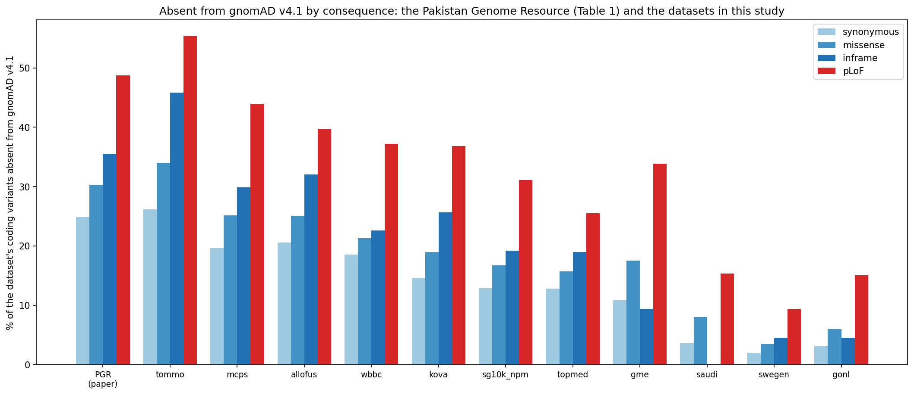

# Comparison with the Pakistan Genome Resource

Koch C, Khalid S, Khan MZ, *et al.* Analysis of 173,303 exomes and genomes in the Pakistan Genome Resource.
*Nature* 656, 670–679 (2026). https://doi.org/10.1038/s41586-026-10667-5

## The study in brief

- 173,303 participants from 23 cities in Pakistan: 166,625 exomes and 6,678 genomes; high autozygosity (30.6% report
  first-cousin parents; mean FROH 0.034).
- 6,625,995 coding variants; 1,974,277 (30%) absent from all of gnomAD v4.1 and 3,113,192 (47%) absent from gnomAD's
  non-South-Asian groups. Absence rises from synonymous (25%) to missense (30%) to pLoF (49%) variants (their Table 1).
- Homozygous loss-of-function variants in 6,476 genes, 2,298 of them not seen homozygous in gnomAD; depletion of
  homozygous LoF in essential, autosomal dominant and recessive disease genes.
- Pakistani populations are genetically closer to European and Middle Eastern groups than to East Asian or African groups.

## Where the findings agree

### 1. Under-represented populations add many variants absent from gnomAD, mostly rare

Share of coding variants absent from gnomAD v4.1, by consequence (PGR: paper Table 1, all of gnomAD, MAC ≥ 1;
this study: exonic variants of protein-coding genes per dataset; `results/09_pgr_comparison/`).

| Dataset | Synonymous | Missense | In-frame | pLoF | pLoF / synonymous |
|---|---:|---:|---:|---:|---:|
| **PGR (Pakistan)** | **24.9%** | **30.3%** | **35.5%** | **48.7%** | **1.96** |
| ToMMo (Japan) | 26.2% | 34.0% | 45.8% | 55.3% | 2.11 |
| All of Us | 20.6% | 25.1% | 32.1% | 39.7% | 1.93 |
| MCPS (Mexico) | 19.6% | 25.2% | 29.9% | 44.0% | 2.24 |
| WBBC (China) | 18.5% | 21.3% | 22.6% | 37.2% | 2.01 |
| KOVA (Korea) | 14.6% | 18.9% | 25.7% | 36.8% | 2.52 |
| SG10K (Singapore) | 12.9% | 16.8% | 19.2% | 31.1% | 2.41 |
| TOPMed | 12.8% | 15.7% | 19.0% | 25.5% | 1.99 |
| GME (Middle East) | 10.8% | 17.5% | 9.4% | 33.9% | 3.13 |
| Saudi | 3.6% | 8.0% | — | 15.4% | 4.30 |
| SweGen (Sweden) | 2.0% | 3.5% | 4.6% | 9.4% | 4.64 |
| GoNL (Netherlands) | 3.2% | 6.0% | 4.5% | 15.0% | 4.74 |

- **Same gradient everywhere.** In every dataset, as in PGR, the share absent from gnomAD rises from synonymous to
  missense to pLoF: damaging alleles are rarer (purifying selection) and so less often already catalogued.
- **Same magnitude for large cohorts of under-represented populations.** PGR's 25% synonymous / 49% pLoF sits with
  ToMMo, MCPS, All of Us and WBBC (19–26% / 37–55%), with pLoF:synonymous ratios of 1.9–2.2 (PGR 1.96).
- European cohorts (SweGen, GoNL), well covered by gnomAD, add far less (2–3% synonymous). Small cohorts have higher
  ratios (Saudi, SweGen, GoNL ≥ 4) because the few variants they contribute beyond gnomAD are mostly rare damaging ones.

### 2. Population structure

The paper places Pakistani populations closer to European and Middle Eastern groups than to East Asian or African
groups. Our mean absolute AF differences (exonic SNVs) agree for gnomAD's South Asian group:

| From gnomAD SAS to | Mean \|ΔAF\| |
|---|---:|
| gnomAD AMR | 0.060 |
| gnomAD MID, gnomAD NFE | 0.067 |
| Saudi | 0.069 |
| East Asian cohorts (ToMMo, KOVA, WBBC, gnomAD EAS) | 0.101–0.105 |
| gnomAD AFR | 0.122 |

Our Middle East marker panel points the same way: its closest other group is most often NFE, then AMR, AFR and SAS,
with EAS least often.

### 3. Consanguineous populations are where population-specific clinical variation concentrates

The paper's homozygous loss-of-function discovery rests on high autozygosity. In our data, the consanguineous Middle
Eastern datasets carry the strongest population-specific clinical signal: GME is the only dataset adding substantial
common coding variation beyond gnomAD (7.5% of common exonic SNVs), it takes part in 17 of the 32 high-confidence
founder pathogenic variants, and it has among the highest carrier burdens (for example PAH 4.3%).

### 4. A national resource is needed for clinical interpretation

The paper presents PGR as a reference for clinical variant interpretation in South Asia. Our ACMG test shows why such
resources matter: adding population frequencies to gnomAD moves 21–37% of one genome's VUS to (likely) benign.

## What the two studies cannot compare

- **Rare vs common.** PGR reports absence from gnomAD for all variants (46% are singletons). Our step 1 also separates
  common variants: for most datasets, common exonic SNVs are almost all already in gnomAD (< 0.5%). PGR does not report
  an AF-stratified figure, so whether its common variants are equally well covered by gnomAD's SAS group is open.
- **Genotype-level results.** Homozygous LoF counts, autozygosity and recall-by-genotype need individual genotypes; our
  study uses summary frequencies only.
- **South Asia is our main gap.** IndiGen (no frequencies) and GenomeAsia (unreliable) were excluded, so our only
  South Asian information is gnomAD SAS and the Indian part of SG10K. Adding PGR summary frequencies, if released,
  would fill it.

## Conclusion

The Pakistan Genome Resource and this multi-population study agree on the pattern (more damaging variants are less
often in gnomAD), on its size for large under-represented cohorts, on population structure, and on the value of
national resources for consanguineous, under-represented populations. They are complementary: PGR adds individual-level
homozygosity, and this study adds the common-variant view across 27 datasets and the clinical frequency checks.
